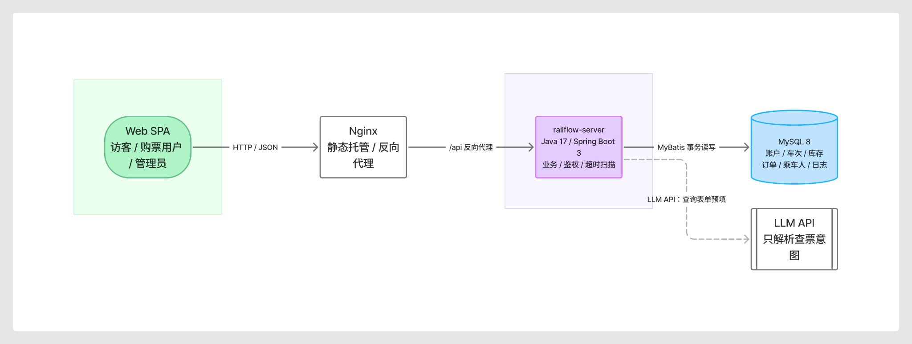
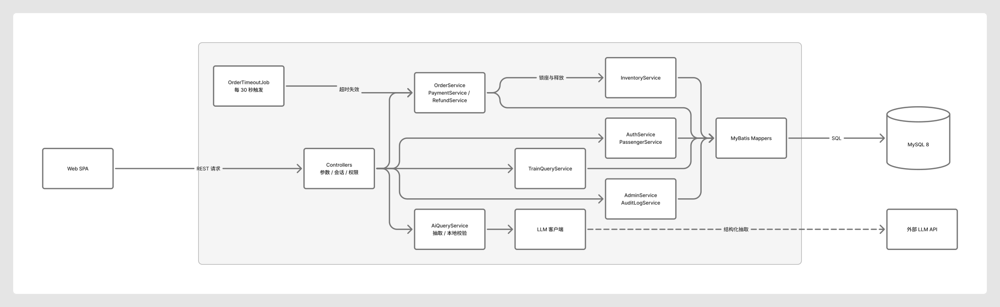
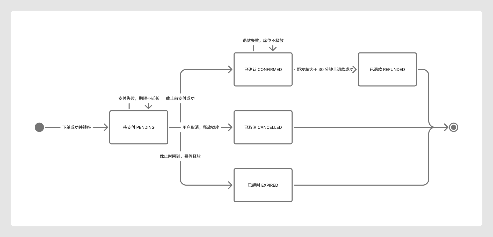
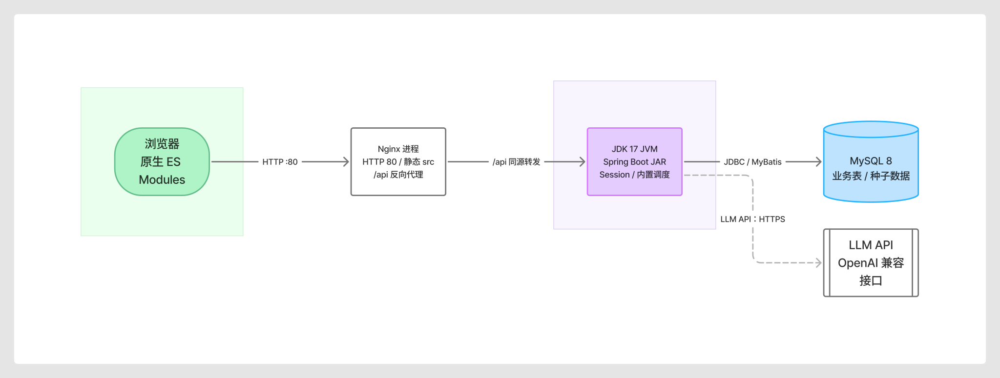

# 架构与关键决策

RailFlow 从「无后端原型」演进为「前端 SPA + Java 后端 + MySQL + 外部 LLM」的真实三层系统。本文档给出逻辑、部署、技术三个架构视图、关键决策记录（ADR）、质量属性与架构风险，并针对系统的 AI 能力说明智能体设计关注点。

## 1. 系统概览（容器视图）



*图 01　系统总体架构（容器视图）*

系统由一个部署单元内的前端、后端、数据库加上外部 LLM 服务组成。除 LLM 外没有任何外部依赖，LLM 不可用时主购票流程不受影响（见 §7 护栏）。

## 2. 逻辑架构

| 组件 | 职责 | 说明 |
| --- | --- | --- |
| Web 前端（src/frontend/） | 车次查询、一句话查票入口、下单、支付、订单、乘车人、管理员页面 | 复用 Part I 原型，替换 mock.js 为真实 API 调用 |
| 接入层 Controllers | REST 接口：认证、车次、AI 解析、订单、乘车人、管理 | 参数校验、会话鉴权、统一异常转 HTTP 状态码 |
| 应用服务层 | AuthService、TrainQueryService、OrderService、PaymentService、RefundService、InventoryService、AdminService、AuditLogService、AiQueryService | 业务规则集中地；事务边界在服务层方法上 |
| 领域层 | Account、Passenger、Train、TrainRun、SeatInventory、Order、OperationLog | 订单状态机与规则实现（需求规则 1–10 的落点） |
| 基础设施层 | MyBatis Mapper、LLM 客户端、@Scheduled 超时任务 | 依赖指向领域层，不反向 |

组件依赖关系如下图，箭头表示调用或依赖，不表示所有请求依次经过全部组件；AI 组件没有通往交易服务的调用边。



*图 02　后端逻辑组件依赖（组件均在同一 JVM 内）*

分层依据 Martin Fowler 的表现层–领域层–数据层分层模式：依赖只能由外向内，业务规则不依赖数据库与 AI 细节，保证 Part III 换实现时可只动外层。接入层的端点、鉴权、错误码与幂等约定见 [api.md](api.md)。

订单状态机（对应需求「订单状态」一节）：



*图 05　订单状态机*

所有状态迁移都用条件更新实现（`UPDATE ... WHERE status = <期望前置状态>`），重复操作天然幂等（规则 6、8）。

## 3. 部署架构



*图 03　部署架构*

- 常规部署：Nginx 托管 `src/frontend/` 静态文件并反向代理 `/api`，后端独立 JVM 进程，MySQL 独立进程——三个部件可同机部署。
- 最简兜底部署（课程演示机受限时）：Spring Boot 直接托管静态资源，`java -jar railflow-server.jar` 单进程 + MySQL；数据库可切 H2 兼容模式（见 ADR-002 后果）。

## 4. 技术架构与选型

| 层面 | 选型 | 备选（已否决） | 关键理由 |
| --- | --- | --- | --- |
| 后端语言 | Java 17 LTS | Python (FastAPI)、Node.js (Express)、21 | 团队技术栈决定（ADR-001） |
| 框架 | Spring Boot 3.x + Spring Web MVC | Django、Ktor | 事务、调度、安全组件开箱即用 |
| ORM | MyBatis | Spring Data JPA | SQL 显式可控，原子扣减语句直观可审（ADR-002） |
| 数据库 | MySQL 8 | H2（演示兜底）、SQLite、PostgreSQL | 行级事务与行锁支撑超卖防护 |
| 构建 | Maven | Gradle | 课程环境通用、配置直白 |
| 前端 | 原生 ES Modules（保持原型） | Vue、React 重写 | 原型已覆盖全部页面，无重写收益（ADR-006） |
| 鉴权 | Servlet Session + Cookie | JWT | 同源部署，无跨端需求（ADR-007） |
| AI | 外部 LLM API（OpenAI 兼容，JSON Schema 结构化输出） | 本地小模型、开源 NLU 规则库 | 一句话查票只需槽位抽取，结构化输出最简（ADR-005） |
| 设计图 | FigJam 图集 + SVG/PNG 原生导出 | draw.io、Mermaid | 可拖动节点与连线编辑，矢量导出清晰，文档直接嵌入 SVG |

## 5. 关键决策记录（ADR）

### ADR-001 后端语言与框架：Java 17 + Spring Boot 3

- 背景：Part I 未定后端，环境检查时曾倾向 Python/uv 路线。
- 备选：Python FastAPI、Django、Node.js Express。
- 决策：采用 Java 17 + Spring Boot 3。
- 理由：团队技术栈于 2026-11 决定改为 Java；Spring 对声明式事务（@Transactional）、定时任务（@Scheduled）、密码哈希等本项目必须能力支持成熟；课程环境 Java 生态通用。
- 后果：`docs/environment.md` 与根 README 的 Python/uv 内容已改写为 Java 17 + Spring Boot 3 + MySQL 8 口径（2026-11-16），并移除 Python/uv 工程文件（`.python-version`、`pyproject.toml`、`uv.lock`、`.venv/`）；原型 mock.js 中模拟的业务规则要在服务端按接口重新实现。

### ADR-002 持久化：MySQL 8 + MyBatis

- 备选：SQLite/H2 文件库、PostgreSQL、Spring Data JPA。
- 决策：MySQL 8 + MyBatis。
- 理由：余票规则（规则 5：总容量 = 可用 + 有效锁座 + 已确认，不得为负）依赖行级事务；原子扣减需要显式 SQL 便于审查与测试；团队对 SQL 直控更有把握。
- 后果：演示机需安装 MySQL 或用 Docker 起库；提供 `schema.sql` + 种子数据脚本一并交付。

### ADR-003 库存扣减：单条 UPDATE 原子操作

```sql
UPDATE seat_inventory SET locked_seats = locked_seats + 1
 WHERE run_id = #{runId} AND capacity - locked_seats - confirmed_seats > 0;
```

影响行数为 0 即无票，多人争抢最后一张票只可能有一人成功（规则 5）。

- 备选：乐观锁版本号、Redis 分布式锁、`SELECT ... FOR UPDATE`。
- 理由：单库场景下一条带条件的 UPDATE 即无竞态，代码最少、失败语义最清晰。
- 后果：需要并发单元测试覆盖（Part III PoC #1 验证点：模拟 100 并发抢 1 张票）。

### ADR-004 订单超时：定时扫描 + 惰性校验双保险

- 决策：`@Scheduled` 每 30 秒扫描 `PENDING` 且 `expire_at <= now` 的订单，条件更新为 `EXPIRED` 并释放席位（幂等，`WHERE status='PENDING'`）；同时支付/查询路径校验截止时间兜底。
- 备选：消息延迟队列（RabbitMQ 死信）、Redis 过期监听。
- 理由：本项目量级小、规则本身允许以服务端时间为准；轮询实现最简单、可观测。
- 后果：最坏情况下席位延迟 30 秒释放；对演示与课程验收无影响。

### ADR-005 AI 接入：外部 LLM 结构化输出，仅做查询预填

- 备选：本地 NLU 规则解析、全站自由对话 Agent。
- 决策：经 OpenAI 兼容接口调用外部 LLM，以 JSON Schema 结构化输出抽取「出发站/到达站/日期」三元组；仅用于查询表单预填。
- 理由：已确认需求「一句话查票」价值高风险低；槽位抽取是 LLM 成熟能力；失败路径明确（退回表单），不触碰任何交易语义。
- 后果：依赖外部服务可用性与费用，需护栏与降级设计（§7）；API Key 须走环境变量不入库不入 Git。

### ADR-006 前端保持原生 ES Modules，不引入框架

- 备选：Vue 3、React 重写。
- 理由：Part I 原型已实现全部页面与交互（含地图选站），重写无净收益；把工作量留给后端与 AI。
- 后果：状态管理继续手写；新增的一句话查票交互简单，可控。

### ADR-007 鉴权：Servlet Session + Cookie

- 备选：无状态 JWT。
- 理由：同源部署、无移动端，Session 最简且登出即失效；角色用 Account.role 区分（用户/管理员），管理员接口统一校验。
- 后果：若未来跨端再演进为 JWT，属低关键决策，留出演进空间。

### ADR-008 订单活跃唯一性：数据库唯一约束兜底

R2 要求同一账户、乘车人、车次不能同时存在多笔 PENDING/CONFIRMED 订单。只在服务层「先查后插」是 check-then-act，并发下两个请求可以同时通过检查。

```sql
ALTER TABLE orders
  ADD COLUMN active_flag TINYINT
    GENERATED ALWAYS AS (IF(status IN ('PENDING','CONFIRMED'), 1, NULL)) STORED,
  ADD UNIQUE KEY uk_active_order (account_id, passenger_id, run_id, active_flag);
```

- 备选：事务内 `SELECT ... FOR UPDATE` 串行化、Redis 分布式锁、仅应用层校验。
- 决策：数据库唯一索引兜底，插入冲突由服务层转成 409 `DUPLICATE_ACTIVE_ORDER`。
- 理由：并发正确性交给数据库，不引入额外组件、不需要锁顺序推理，与 ADR-003「单库原子操作优先」一致。
- 后果：状态一变生成列自动变值；已取消/已超时/已退款订单 `active_flag` 为 NULL，MySQL 唯一索引允许多个 NULL，历史订单不受约束。H2 兜底部署需确认生成列语法，Part III 的并发 PoC 增加一条「同乘车人同车次并发下单，仅 1 笔成功」。

## 6. 质量属性与架构支撑

| 质量属性 | 优先级 | 架构如何支撑 |
| --- | --- | --- |
| 一致性（不超卖、不重复下单、不重复扣退） | 最高 | 服务层事务 + 库存原子 UPDATE + 状态机条件转移 + 订单活跃唯一索引（规则 2、5、6、8） |
| 可用性 | 高 | 除 LLM 外零外部依赖；AI 失败静默降级，核心流程不受影响 |
| 幂等性 | 高 | 重复支付/取消/退款被状态前置条件挡住，操作记录可追溯（规则 8、10） |
| 性能 | 中 | 车次查询按（出发站、到达站、日期）建索引；演示规模无需缓存 |
| 可维护性 | 中高 | 分层依赖单向、业务规则集中在服务层、设计图以 SVG 随代码版本化 |
| 安全（演示级） | 中 | BCrypt 密码哈希、资源属主校验（用户仅见本人数据）、管理员接口角色校验 |

## 7. 智能体（Agentic）设计关注点

RailFlow 的 AI 能力是**确定性编排下的工具调用**，不是自主多轮 Agent，设计上明确写清五件事：

- **Agent 角色**：单一「查询意图解析器」（Query Intent Parser）。没有自主规划、没有多 Agent 协作。
- **工具接口**：`parseQuery(text) -> { fromStation, toStation, date }`，输出必须过 JSON Schema 校验 + 站点字典白名单，非法值直接判失败。
- **记忆与状态**：不保存对话历史、无跨会话记忆；每次解析独立。
- **编排**：前端收集输入 → AiQueryService 调 LLM → 本地校验 → 回填表单 → **用户可修改并确认** → 才复用既有 `/api/trains` 查询。AI 无法跳过用户确认触发任何动作。
- **护栏（Guardrails）**：
  1. AI 仅限只读查询域，物理上不接入下单/支付/退票接口；
  2. 站名白名单 + 日期以**服务端时间**解析（呼应规则 4），杜绝幻觉班次；
  3. LLM 调用 5 秒超时，失败回退表单并提示；
  4. 票价、余票等业务事实一律以数据库为准，AI 只填槽位、不生成业务答案；
  5. AI 接口与普通接口同等鉴权。

## 8. 架构风险与缓解

| 风险 | 影响 | 缓解 |
| --- | --- | --- |
| 外部 LLM 不可用或产生费用超预期 | 一句话查票不可用 | 超时回退表单；开发期缓存 LLM 响应做 mock；设置调用上限 |
| 并发扣减实现缺陷导致超卖 | 破坏最核心业务规则 | ADR-003 单语句原子操作 + Part III 并发 PoC 压测 |
| 课程演示机无 MySQL/JDK 17 | 无法演示 | 最简兜底部署（单 jar + H2 兼容模式）写入部署说明 |
| AI 功能范围蔓延拖垮进度 | 延误交付 | 只有一句话查票进本迭代实现，其余候选功能需评审排级后另行排期 |
