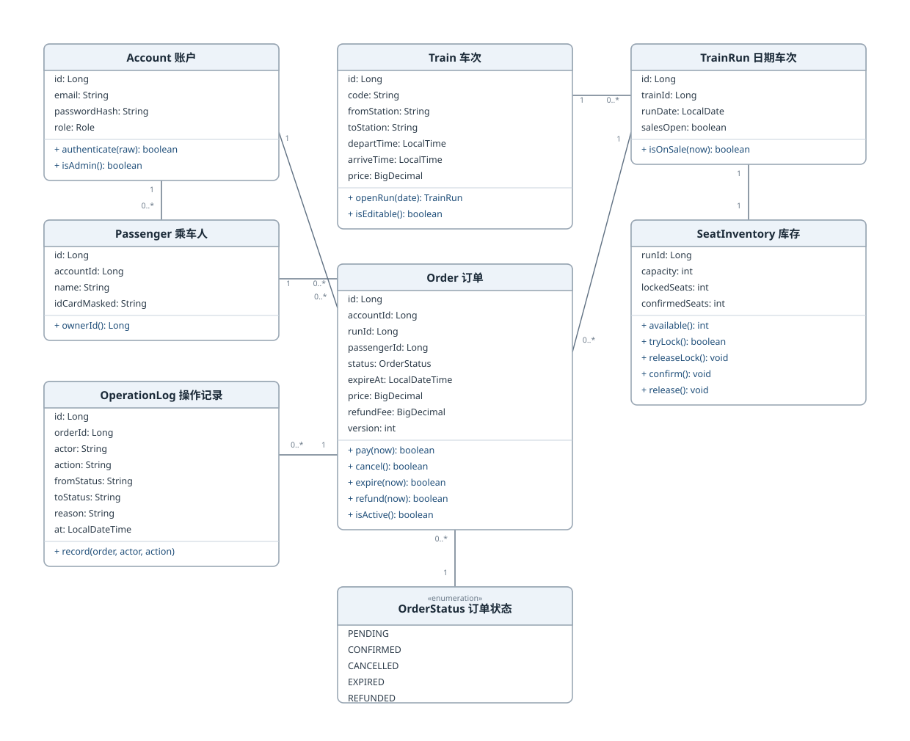
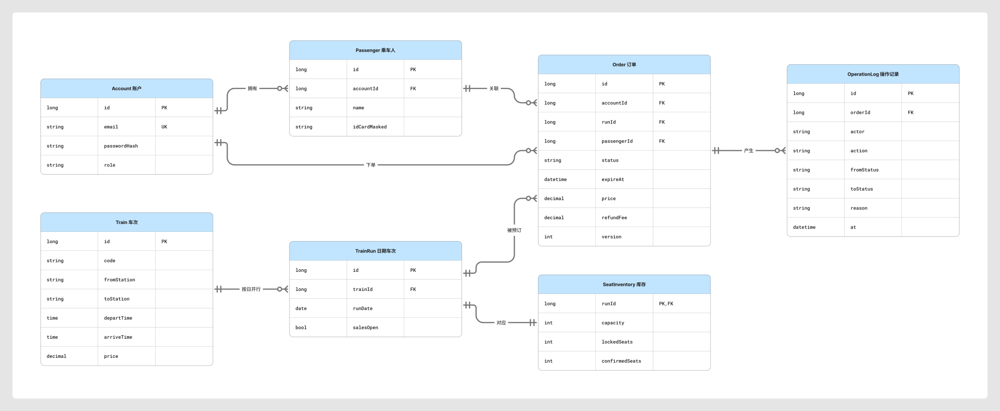
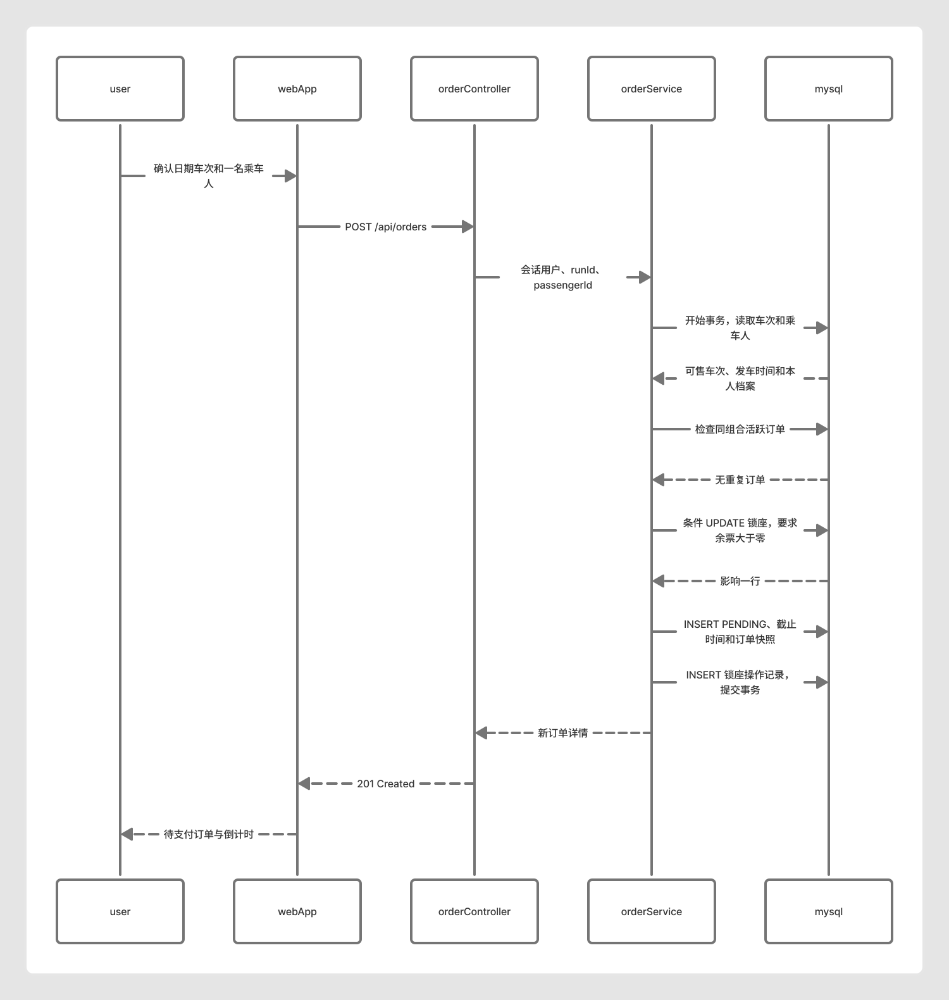
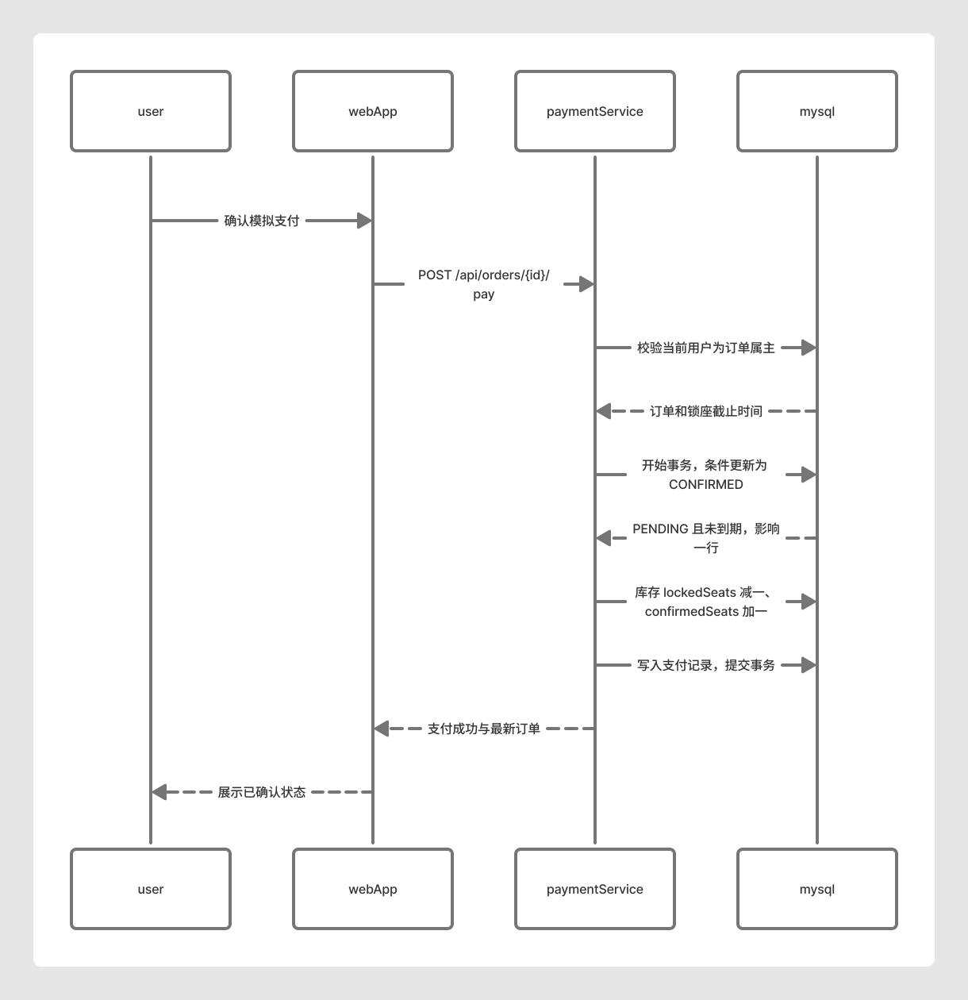
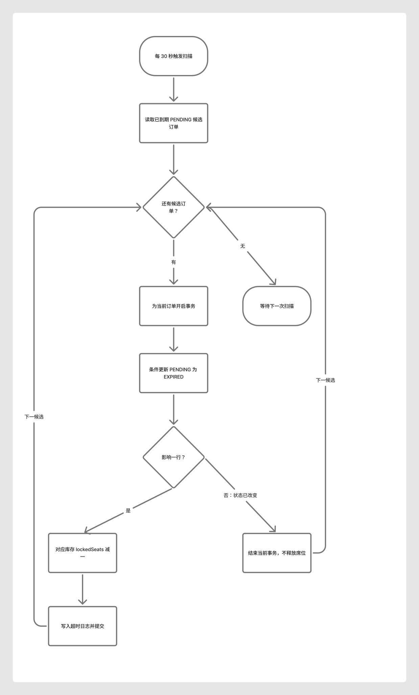

# 设计模型

本文档用类图、实体关系图、状态图与顺序图刻画 RailFlow 的领域结构与关键用例实现。模型与 [requirements.md](requirements.md) 的业务规则一一对应，规则编号在图中以 R1–R10 标注。

## 1. 领域模型

领域模型分两层看：**类图**（图 11）给出关键抽象的属性与职责，**数据关系图**（图 04）给出实体间的基数与关联。

### 1.1 领域类图

*图 11　领域类图（属性与职责；关联基数见图 04）*

四个状态迁移方法 `pay / cancel / expire / refund` 都以「期望前置状态」为条件更新，返回是否迁移成功，失败不改任何数据；`SeatInventory` 的锁座与释放同样落到一条条件 UPDATE 上（ADR-003）。

### 1.2 数据关系

*图 04　领域数据关系*

设计要点：

- **订单持快照**（R9）：Order 冗余存储下单时刻的出发/到达站、发车时间、乘车人姓名与票价，后续车次或档案变更不影响已有订单（车次产生订单后只允许切换销售开关）。
- **乘车人删除用软删除**（R9）：Passenger 加 `deleted_at`，删除只打标记；存在 PENDING/CONFIRMED 订单时拒绝删除（409）。订单靠自身快照可读，不退化为主键悬空引用。
- **一对多关系**（R1）：每笔订单恰对应一个账户、一个日期车次（TrainRun）、一名成人乘车人、一个席位、一种席别全程票。
- **库存不变式**（R5）：`capacity = available + lockedSeats + confirmedSeats`，任何时刻余票≥0，由 ADR-003 的原子 UPDATE 保证。
- **防重复下单**（R2）：服务层前置校验之外，订单表的活跃唯一索引（ADR-008）兜底；并发重复下单由数据库拒绝并返回 409。

## 2. 订单状态机

状态机即 [architecture.md](architecture.md) §2 中的图；此处补充**迁移条件**与规则映射：

| 迁移 | 触发 | 前置条件（条件 UPDATE 的 WHERE 子句） | 规则 |
| --- | --- | --- | --- |
| → PENDING | 下单锁座 | 库存原子扣减成功；无重复活跃订单 | R2、R3、R5 |
| PENDING→CONFIRMED | 模拟支付成功 | status=PENDING 且 now < expireAt | R4 |
| PENDING→CANCELLED | 用户取消 | status=PENDING | R6 |
| PENDING→EXPIRED | 超时扫描/惰性失效 | status=PENDING 且 expireAt ≤ now | R3、R6 |
| CONFIRMED→REFUNDED | 模拟退款成功 | status=CONFIRMED 且 距发车 > 30 分钟 | R7 |
| （不变） | 支付失败/退款失败 | 条件不满足时状态保持，席位不变 | R6、R8 |

所有迁移同时写 OperationLog（R10：时间、操作者、状态变化、原因），重复请求因前置条件已不满足而天然幂等。

## 3. 关键用例实现（顺序图）

### 3.1 下单锁座（含多人争抢最后一张票）

*图 06　下单锁座成功时序*

异常分支不在图中：已有同组合活跃订单、或库存条件更新影响零行（含并发争抢最后一张票的失败方）时返回 409，锁座与订单写入整体回滚。

### 3.2 模拟支付 + 超时兜底

*图 07　模拟支付成功时序（截止前成功路径）*

模拟支付失败不改任何状态，也不延长原锁座期限，可在期限内重试；影响零行（已过期、已取消、重复支付）返回 409。

超时兜底由定时扫描独立完成：

*图 08　超时扫描与幂等释放*

### 3.3 一句话查票（AI 只预填，不越权）

*图 09　AI 查票成功时序*

LLM 超时或返回不合法时返回 422 并回退手动表单；日期以服务端时间解析（R4），票价与余票始终以数据库为准。

## 4. 用例—组件映射

| Part I 用例 | 参与组件 | 规则落点 |
| --- | --- | --- |
| 账户访问 | AuthController / AuthService / BCrypt | R10 角色 |
| 乘车人管理 | PassengerController / PassengerService | R9 软删除与快照、R10 属主 |
| 车次查询 | TrainController / TrainQueryService | R3 查询不占库存 |
| 一句话查票（新增） | AiQueryController / AiQueryService + LLM | AI 边界（architecture §7） |
| 下单锁座 | OrderController / OrderService / InventoryService | R2、R3、R5 |
| 模拟支付 | PaymentController / PaymentService | R4、R6、R8 |
| 订单查询 | OrderController / OrderService | R10 属主 |
| 取消与超时 | OrderService / OrderTimeoutJob | R3、R6 |
| 模拟退票 | RefundService | R7、R8 |
| 车次管理 | AdminController / AdminService | R9 不可变更限制 |
| 操作记录 | AuditLogController / AuditLogService（只读） | R10 只读 |
