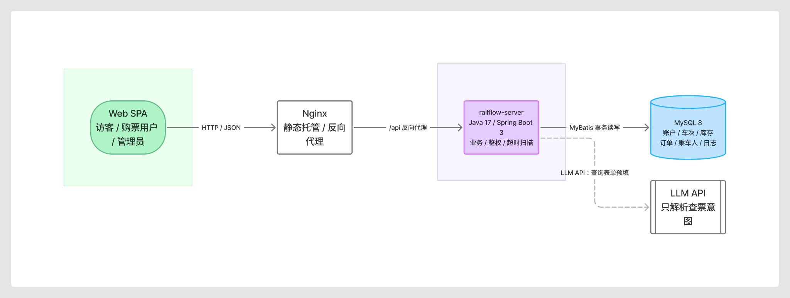
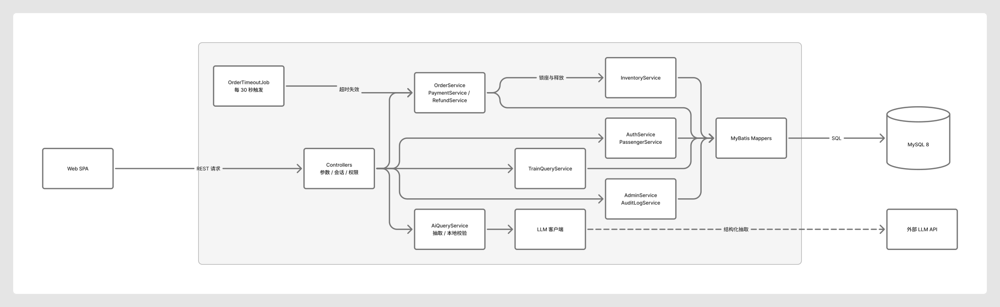
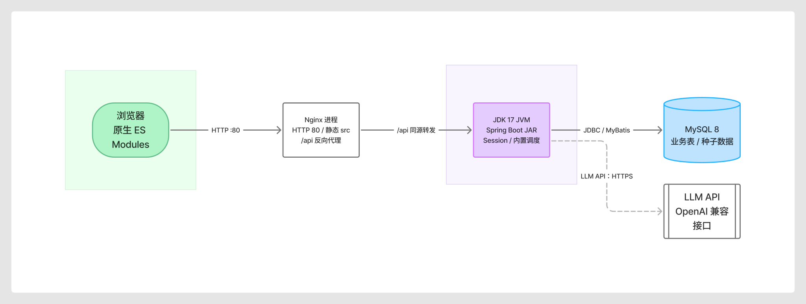
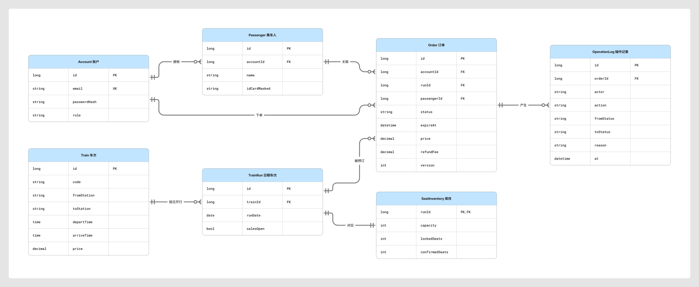
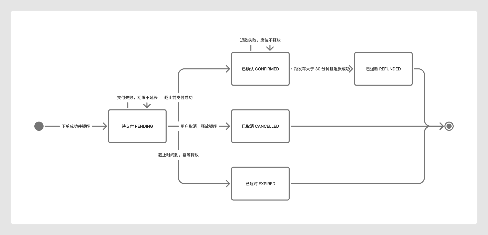
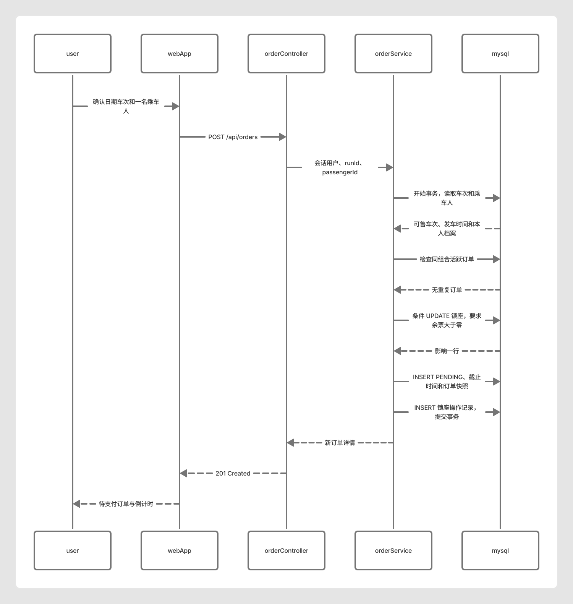
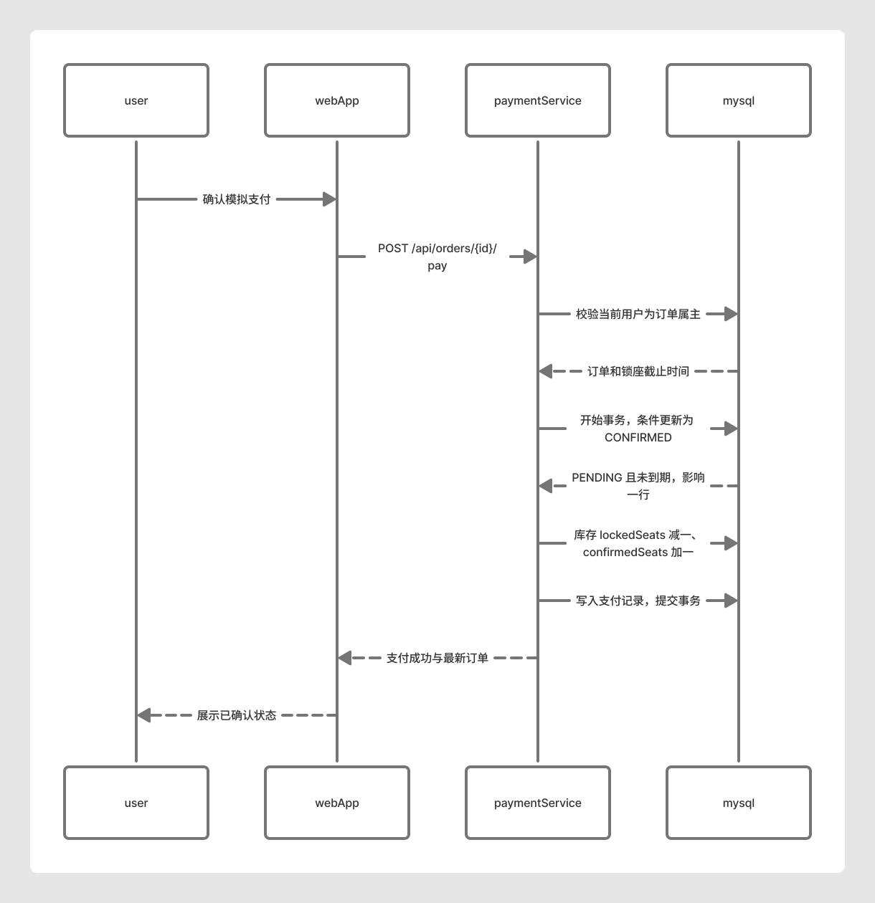
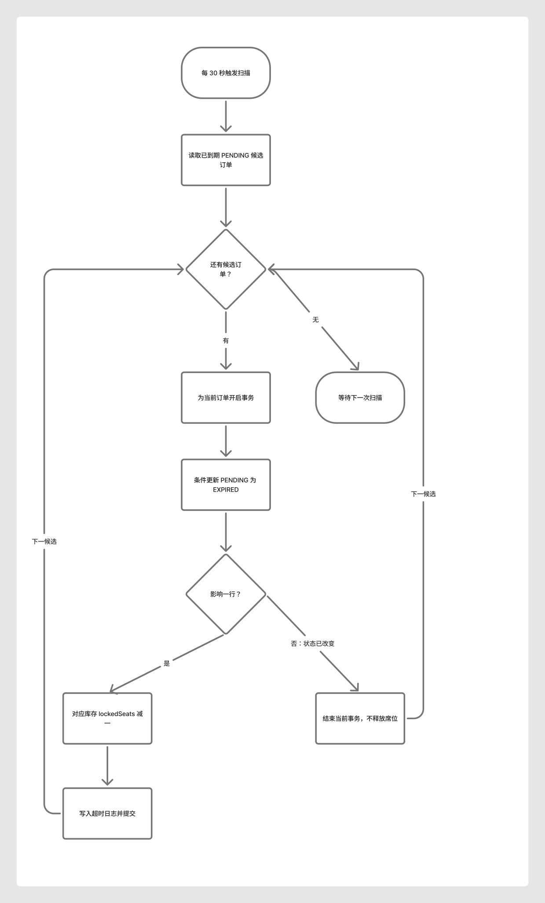
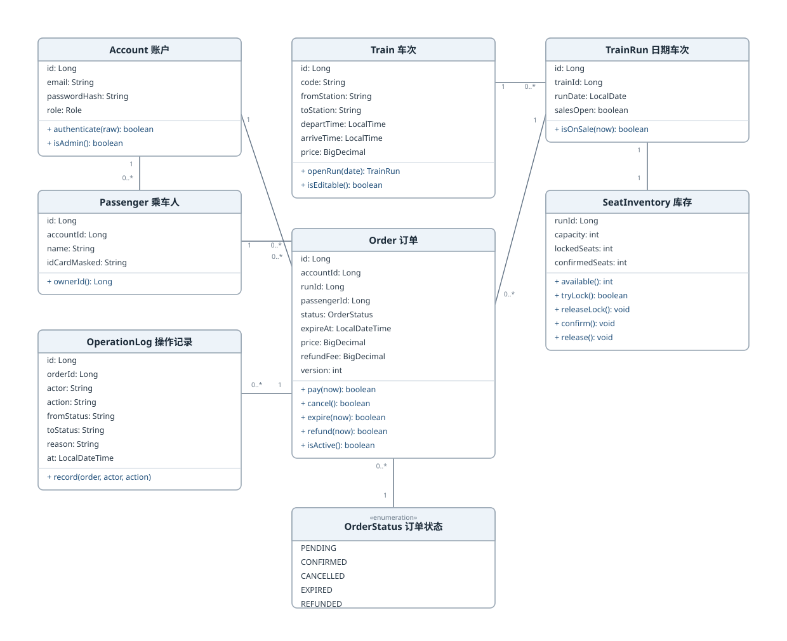

# RailFlow 设计图集

本图集对应 Part II 目标设计，不表示 Java 后端已经实现。依据 `architecture.md`、`design-models.md`、`requirements.md`、`requirements-update.md` 与 `ui-ux.md` 整理。

已使用 Figma 插件的 `figma-generate-diagram` 技能生成 10 张可编辑设计图（01–10），统一保存在 [RailFlow FigJam 图集](https://www.figma.com/board/H6iQuZDMjtkllAfGDTAkHj)。每张图有独立章节，可单独查看、修改与导出。图 11 领域类图不在 FigJam 中，为本地矢量绘制，用于补齐「关键抽象的职责与方法」。

最终文件：`svg/` 为 11 张 SVG（01–10 从 FigJam 原生导出，11 本地绘制），本文档与各设计文档均直接嵌入 SVG；`png/` 为对应的 11 张 PNG；`editable/` 保存 10 份可编辑图源。FigJam 是可拖动节点与连线的原生可编辑版，`editable/` 便于版本管理与重新生成。

工具不支持 UML 类图与原生 C4 语法；图 01 用架构流程图表达系统边界，图 04 用 ER 图表达数据关系，不将 ER 图称为 UML 类图。时序图不保留 alt/loop，因此成功路径分别绘制，异常分支由状态图、流程图和下方说明表达。

| 编号 | 图 | 图源类型 |
| --- | --- | --- |
| 01 | 系统总体架构 | flowchart；架构布局 `FIGMA_DIAGRAM_2026` |
| 02 | 后端逻辑组件依赖 | 标准 flowchart；组件均在同一 JVM 内 |
| 03 | 部署架构 | flowchart；架构布局 `FIGMA_DIAGRAM_2026` |
| 04 | 领域数据关系 | erDiagram |
| 05 | 订单状态机 | stateDiagram-v2 |
| 06 | 下单锁座成功时序 | sequenceDiagram |
| 07 | 模拟支付成功时序 | sequenceDiagram |
| 08 | 超时扫描与幂等释放流程 | flowchart |
| 09 | AI 查票成功时序 | sequenceDiagram |
| 10 | AI 查票与手动降级用户流程 | flowchart |
| 11 | 领域类图 | UML 类图；本地绘制，非 FigJam |

## 01 系统总体架构

AI 失败只影响预填；常规查询、下单、支付、退票继续走后端与数据库。支付和退款均为模拟，不引入银行或真实铁路接口。

## 02 后端逻辑组件依赖

箭头表示调用或依赖，不表示所有请求都依次经过全部组件。服务层承担事务边界；AI 组件没有通往交易服务的调用边。

## 03 部署架构

Nginx、JVM、MySQL 是三个进程，可同机部署；超时任务在 JVM 内，不是第四个部署单元。Spring Boot 托管静态资源及 H2 兼容模式为文档中的演示兜底方案，不与常规部署混画。

## 04 领域数据关系

这是领域数据视图，不是完整建表脚本。订单还须保留下单时的站点、发车时间、乘车人姓名快照（R9），此处压缩字段以保持可读；乘车人删除后订单快照及关联的保留方式仍需在物理数据设计中明确。库存满足 `capacity = available + lockedSeats + confirmedSeats`。活跃订单重复校验不能仅凭这张 ER 图证明并发安全，仍需实现与 PoC 验证。

## 05 订单状态机

锁座截止时间为下单后 10 分钟与发车时间的较早者；支付和退票时间判断均以服务端时间为准。取消、超时、支付、退款使用期望前置状态的条件更新，库存与日志在同一事务内处理。退款手续费为锁定票价的 10%。

## 06 下单锁座成功时序

前置校验还须拒绝未登录、越权乘车人、停售及已发车预订。已有同组合活跃订单返回 409；库存更新影响零行返回 409 无余票。事务失败回滚锁座与订单写入。单条库存条件更新保护最后一张票，重复活跃订单的并发约束仍须另行验证。

## 07 模拟支付成功时序

条件更新以服务端时间判断 `expireAt > now`。影响零行时返回 409，不确认、不重复改库存。模拟支付失败保持 PENDING，且不延长原锁座期限。服务层入口包含参数与权限校验，图中省略 Controller 转发。

## 08 超时扫描与幂等释放

状态条件包括 `status=PENDING` 且 `expireAt <= now`。只有本事务成功转移状态的订单才释放一次库存；失败回滚状态、库存和日志。支付路径同时惰性校验截止时间，不能利用两次扫描之间的间隙支付。该图将原设计的“对应行、幂等释放”具体表达为逐单事务，批处理优化留待实现验证。

## 09 AI 查票成功时序

LLM 超时上限 5 秒；超时、非法响应、站名不合法或缺槽位均回退手动表单，见图 10。AI 不产生票价或余票，不调用下单、支付、退票。访客查询与 AI 解析开放，预订前登录，以 `requirements-update.md` 的明确角色规则为准。

## 10 AI 查票与手动降级用户流程

成功预填后仍须用户确认。手动表单始终保留；AI 不可用不会阻断查询和购票。缺失出发站等信息时不猜测补全；“明天下午去杭州”这类缺槽位示例须按此规则回退或由用户补齐。

## 11 领域类图

八个关键抽象：Account、Passenger、Train、TrainRun、SeatInventory、Order、OperationLog，以及枚举 OrderStatus。属性只保留设计决策用得上的字段，方法只列承担业务规则的那几个——`SeatInventory.tryLock` 对应 R5 的原子扣减，`Order.pay/cancel/expire/refund` 对应 R4/R6/R3/R7 的条件迁移。关联的基数与引用关系见图 04，此处不重复标注，避免两张图信息打架。

## 生成及验收说明

- FigJam：10 张图（01–10）已生成并整理成独立章节；SVG 与 PNG 使用同一 FigJam 章节原生导出。图 11 为本地矢量绘制，SVG 为源文件，PNG 由浏览器渲染。
- 总体架构、部署图传入 `useArchitectureLayoutCode: FIGMA_DIAGRAM_2026`；内部组件依赖图使用标准布局，避免将逻辑模块误画成独立服务。
- 每次调用前加载指定技能；首次成功后复用文件 key，并创建 Figma 文件会话，其余图使用同一会话与文件。
- 图源无 HTML 标签、转义换行或表情；时序图不使用会被丢弃的别名、分支框和注释。
- 权限、库存并发与订单快照的实现细节仍须 Part III 验证；这些设计图不替代验证结果。
