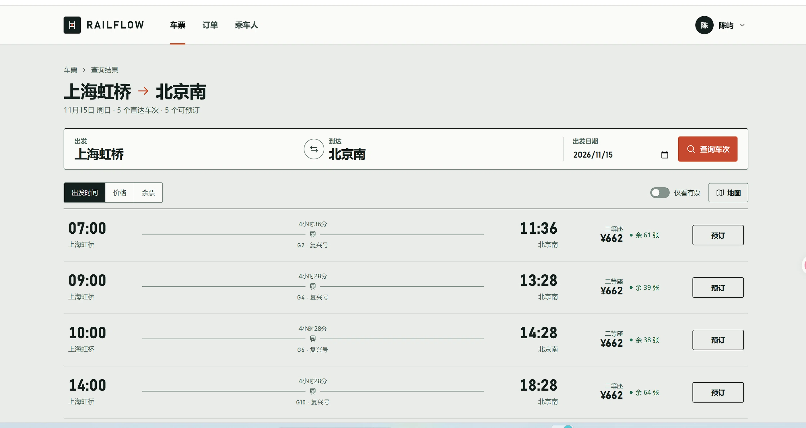
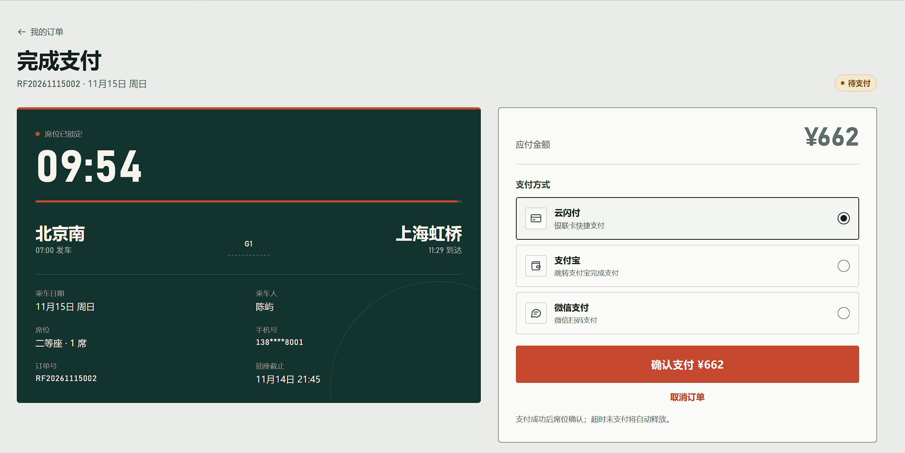
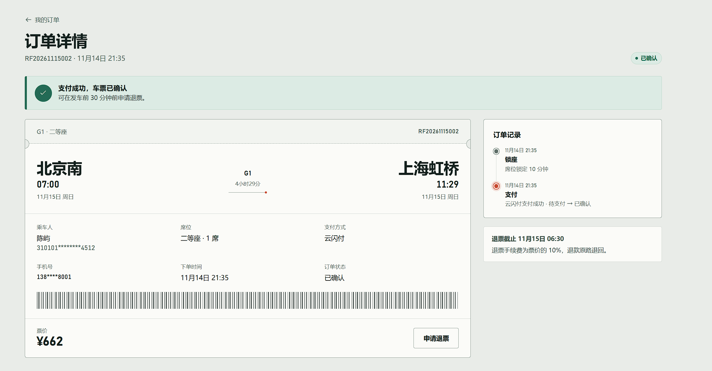
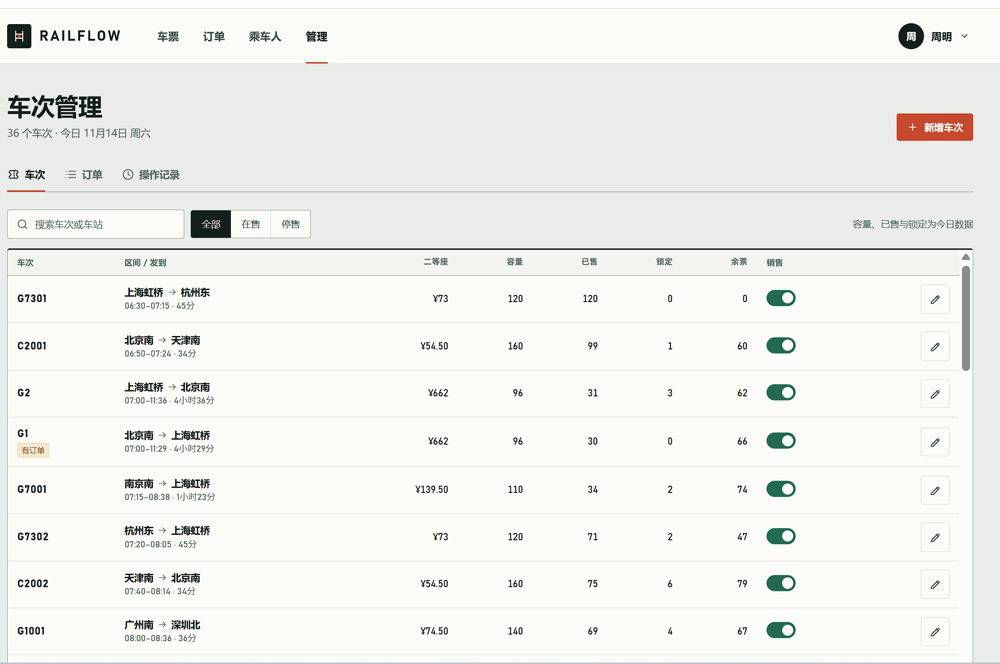
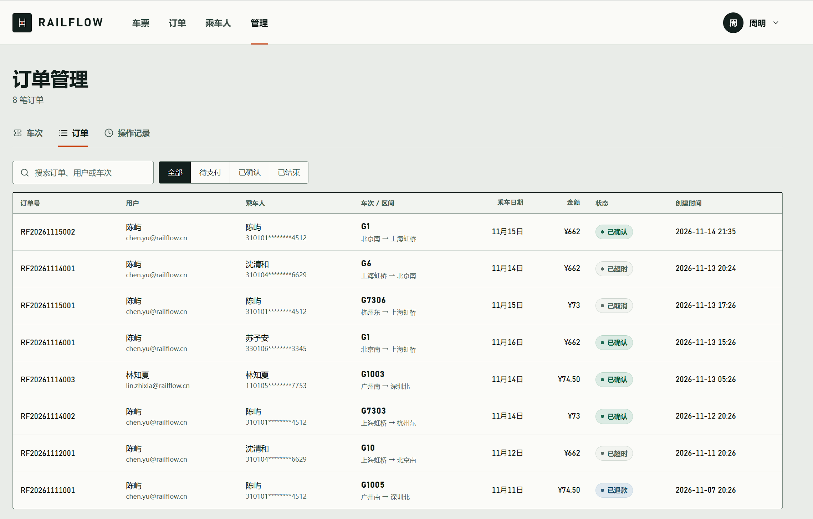
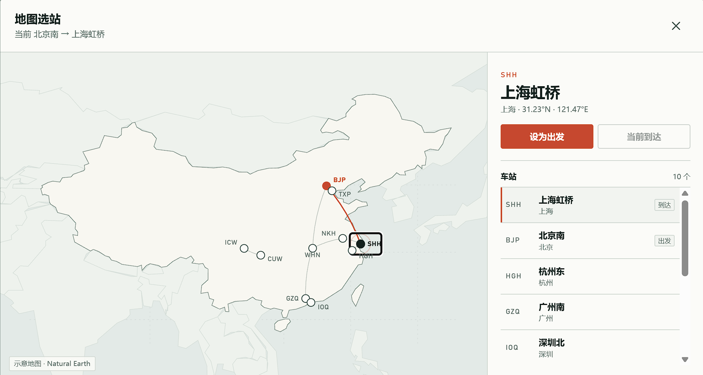
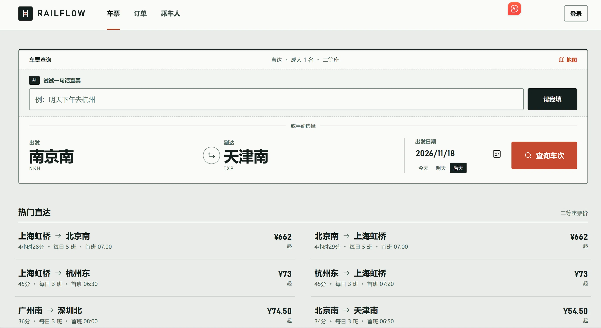
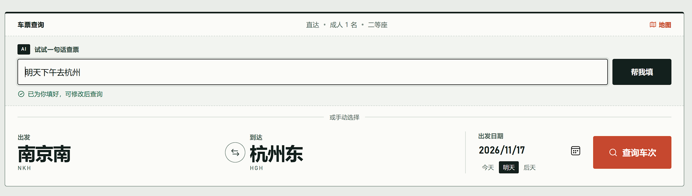
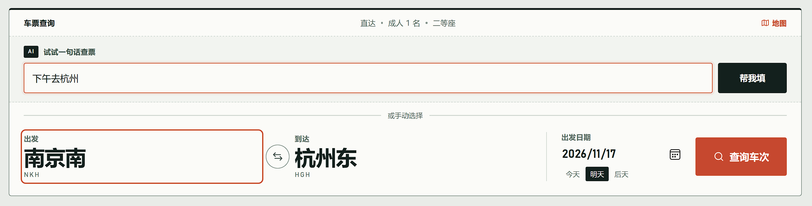

# UI 与 UX 设计

Part I 原型已完整覆盖购票闭环的界面（`src/frontend/`），本设计**不推翻原型**，只做两类改动：接入真实后端后的数据层替换，与为「一句话查票」新增的输入层交互。界面 mockup 与用户流程如下。

## 1. 现有页面盘点（保持不变的部分）

| 页面 | 现状 | 本轮改动 |
| --- | --- | --- |
| 首页查询卡 + 地图选站 | 三框（出发/到达/日期）+ 地图点选 | 顶部新增一句话输入框（见 §2） |
| 登录/注册 | 弹窗，含快速进入 | 仅替换数据源 |
| 乘车人管理 | 增删改虚构成人档案 | 仅替换数据源 |
| 下单确认 + 模拟支付 | 锁座提示、倒计时、支付结果 | 展示真实服务端状态（倒计时以服务端时间为准） |
| 订单中心 | 状态、金额、截止时间、操作历史 | 新增会话失效处理；状态实时来自服务端 |
| 管理端 | 车次维护、操作记录 | 权限走服务端角色校验 |

## 2. 一句话查票的界面与交互

### 2.1 查询卡布局（文字 mockup）

```text
┌──────────────────────────────────────────────┐
│  🄰 试试一句话查票                             │
│  ┌────────────────────────────────┐ ┌─────┐  │
│  │ 例：明天下午去杭州               │ │帮我填│  │
│  └────────────────────────────────┘ └─────┘  │
│  ───────────── 或手动选择 ─────────────        │
│  出发站 [ 上海  ]   到达站 [ 杭州 ]            │
│  日期 [ 2026-11-15 ]                           │
│  [ 查 车 次 ]                                  │
└──────────────────────────────────────────────┘
```

- AI 输入框与普通表单**并存**，视觉上作为「捷径」放在卡顶，手动表单保留（折叠线以下）——AI 是增强不是替代。
- 解析成功：三个框自动填好并高亮约 1.5 秒，同时在输入框下方提示「已为你填好，可修改后查询」。
- 解析中：按钮转圈（骨架态），超过 5 秒走失败路径。
- 解析失败：toast「没听懂，请手动选择站点和日期」，焦点落到出发站框；AI 输入框内容保留，方便用户改写重试。

### 2.2 用户流程


*图 10　AI 查票与手动降级用户流程*

关键原则：

1. **用户永远有最终确认权**——AI 只预填，提交键在用户手里（对应架构护栏 §7）。
2. **静默降级**——任何 AI 异常都退回原有手动路径，用户任务不中断。
3. **不新增页面**——AI 入口嵌在现有查询卡内，导航与信息架构零变化。

## 3. 后端接入带来的体验变更

| 触点 | 变更 | 说明 |
| --- | --- | --- |
| 待支付倒计时 | 以服务端时间为准渲染 | 前端本地时钟仅做显示误差修补 |
| 支付失败/退票失败 | 演示用隐藏触发保留（Alt+点击） | 与 Part I 演示习惯一致 |
| 会话过期 | 跳转登录弹窗，操作后回到原页面 | Session 过期统一处理 |
| 错误文案 | 服务端 409（无票/重复/过期）给出一句话原因 | 与操作记录中的 reason 一致 |

## 4. 界面原型与截图

界面以可运行原型为准：`src/frontend/` 通过 `http://127.0.0.1:8123/` 打开，本目录不含设计稿文件。截图共 9 张，统一放在 [ui-mockups/](ui-mockups/README.md)：01–03 为首页与一句话查票，04–09 为现有页面；构建与拍摄口径见该目录 README，汇报 PPT 直接取这些图加标注。

### 4.1 现有页面（Part I 原型）



*车次列表：时刻、历时、票价与余票，右侧为预订入口*



*待支付订单：锁座倒计时、席位信息与支付方式*



*订单详情：票面信息、订单记录与退票入口*



*管理端车次管理：容量、已售、锁定、余票与销售开关*



*管理端订单管理：按状态筛选与订单明细*



*地图选站：线路、站点与设为出发/到达*

### 4.2 一句话查票：入口、预填与降级



*首页查询卡：顶部是一句话输入框与「帮我填」按钮；虚线以下保留出发/到达/日期三要素、日期快捷选择与地图入口*



*预填成功：输入「明天下午去杭州」后点「帮我填」，到达站填为杭州东、日期落到明天，三个框高亮，输入框下方提示「已为你填好，可修改后查询」*



*解析失败：缺出发站时不猜测补全，输入框标红，toast 提示「没听懂，请手动选择站点和日期」，焦点落回出发站*
