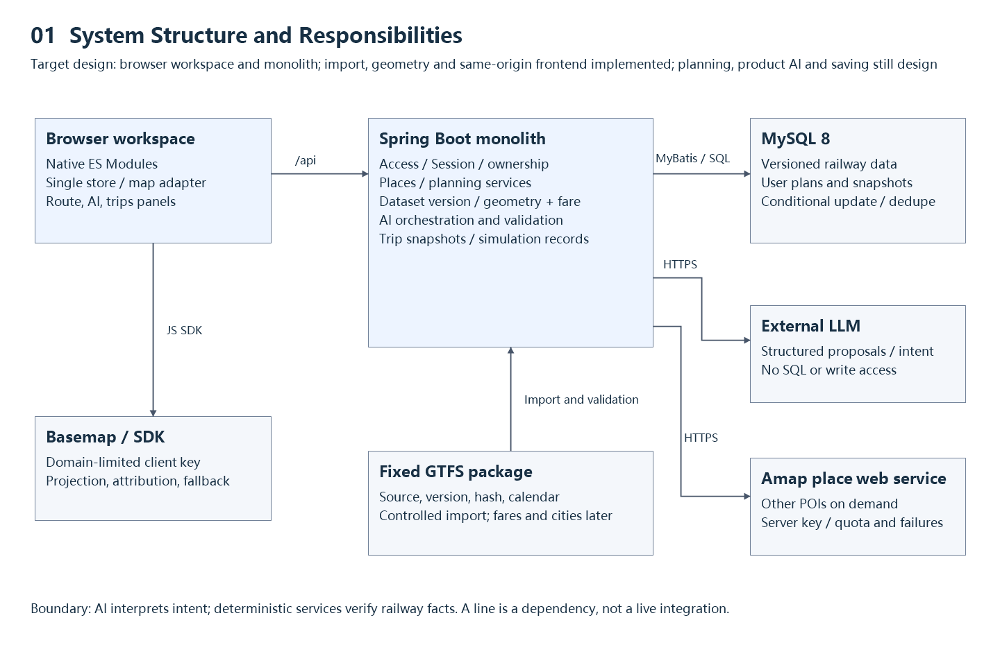
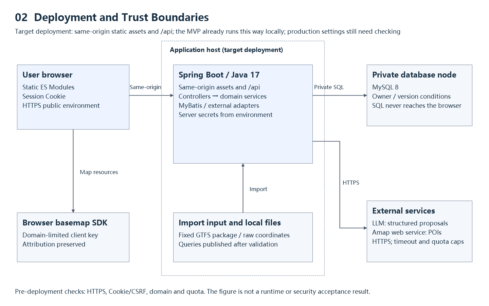

# Architecture and Key Decisions

Sihan Li | 2453202 | Version CD-20261119 | Course design document, independently reviewed

## 1. Problem and Boundaries

The system resolves consistency among ordered cities, railway timetables, calendar-day stays, and map track geometry. Generative models interpret intent; railway feasibility rests on versioned data and deterministic computation. Geometry, timetables, and prices each express confidence independently, and no gap in one is masked by another's "success".

Confirmed product scope appears in [Updated Requirements](requirements-update.md) within this delivery. The import, geometry, and same-origin frontend of this MVP round are implemented and have passed acceptance; planning, product AI, and save for the complete product remain design, with scope and exit conditions in [Requirements §2.1](requirements-update.md#scope-boundary). Existing technology choices carry over. For new module partitioning, internal operations, and validation parameters, implemented parts follow the MVP contract; unimplemented parts remain design proposals, not a finalized API or new business rules.

## 2. System-Level and Logical View

Figure 1: Containers and primary responsibilities of the target system; [editable SVG](figures/01-system-architecture.svg). Connections denote design dependencies, not services already connected.

| Module | Inputs and outputs | Responsibility boundary |
| --- | --- | --- |
| Browser workspace | Cities/stations, dates, preferences → map, candidates, and explanations | Single store; business data reached only through the data adapter; the current fixture mode keeps clear sample markers |
| Access layer | Validated request → unified result/error | Parameters, Session, owner, request identifier; components do not assemble business SQL |
| Place service | Text/entity ID → local city, station, or external POI | Distinguishes city and station identity; Amap results cannot serve directly as railway station codes |
| Planning service | Ordered nodes, versions, and conditions → candidates and failure reasons | Station matching, service day, connection, transfer counting, invalidation propagation; the model never computes ticketing facts |
| Data and geometry service | Fixed GTFS, train run instances, and segments → traceable timetables/track geometry | Validates foreign keys and calendars, clips shapes in order, keeps the original WGS84 coordinates; historical fares adapt independently |
| AI orchestration service | Messages and itinerary snapshot → follow-up question/validated modification/explanation | Tool allowlist, structure validation, version checks, and bounded calls; no SQL or transaction privileges |
| Itinerary service | User, snapshot, version, request ID → save/restore result | Per-owner isolation, conditional update, idempotent verification, simulated-record snapshot; separate from planning computation |
| MyBatis and external adapters | Domain query/write → data or explicit exception | Parameter binding and environment variables; raw upstream messages are never shown directly to users |

Modules reside in one Spring Boot application and communicate through plain method calls. The current course scale needs no microservices, message queue, vector database, or extra cache infrastructure. Import and online planning stay separate; no database write transaction stays open during an external LLM call.

## 3. Deployment View

Figure 2: [editable SVG](figures/02-deployment.svg).

The proposed course deployment serves the static frontend and `/api` from the same-origin Spring Boot application connected to a private MySQL; fixed GTFS packages pass a controlled import before queries are served. Browsers reach the basemap service under SDK rules, while general place web services and the LLM are called through the backend. This shape has landed locally under the `web` profile: one Spring Boot process mounts `src/frontend` and `/api`, connects to a private MySQL 8, and the browser loads the Amap basemap. Certificates, domains, account quotas, and production parameters still await verification before deployment; local demonstrations use the loopback address.

Deployment keeps Java 17 and the Maven build; running the upstream Python collector is not required, and nationwide shapes are not sent to the browser. Public environments configure HTTPS, Cookie HttpOnly/Secure/SameSite attributes, CSRF protection, and allowed origins; local demonstrations use the loopback address. Actual certificates, domains, and account quotas are verified before deployment, and no diagram is taken to mean deployment is complete.

Server keys come from environment variables; the browser map SDK uses client credentials restricted by domain and must not reuse server web-service or LLM keys. Logs record only request identifier, version, elapsed time, and normalized errors, never passwords, full conversations, or keys.

## 4. Technical View and Decision Rationale

| Decision | Adopted/carried over | Alternatives compared | Rationale and consequences |
| --- | --- | --- | --- |
| T01 Application boundary | Java 17 + Spring Boot 3 monolith; carries over ADR-001 | Backend in a new language, microservices | Keeps the team's accumulated capability and adds no deployment unit; module boundaries are expressed through interfaces and responsibilities |
| T02 Persistence | MySQL 8 + MyBatis; carries over ADR-002 | All-localStorage, general-purpose ORM | Version, owner, and conditional writes need database guarantees; explicit SQL is easy to inspect, while migrations and indexes need separate verification |
| T03 Frontend | Native ES Modules; carries over ADR-006 | Rewrite in Vue/React | The existing workspace is reusable and no build step is added; request validity concentrates in the store/adapter |
| T04 Identity | Session + Cookie; carries over ADR-007 | JWT | A same-origin course system needs no extra token management; CSRF and session-expiry recovery must be implemented |
| T05 Railway input | Fixed GTFS packages and associated shapes; requirements C28–C30 | Real-time ticketing API, AI-generated routes | Source and date are traceable and fit the budget; fares and city attribution still need to be supplied, and existing data does not make geometry correct |
| T06 Product AI | Controlled orchestration + structured modification; detailed design proposal | Single-pass slot prefill, model autonomously running arbitrary tools | Supports multiple rounds while bounding actions; tool facts and user conditions survive, and complexity moves into validation and version control |
| T07 Place division of labor | Local cities/stations + Amap for other POIs; requirement C27 | Full POI scraping, POI used directly as railway entity | Reduces data maintenance and avoids identity confusion; POI quotas for the complete product still await resolution. This round's basemap carries over the Amap JS API 2.0 adaptation direction, with the frontend as the sole coordinate converter, implemented per the MVP contract; real loading and alignment checks against three sample train runs are complete, while POI lookup is not yet connected |
| T08 Save | User snapshot + conditional version + request ID; detailed design proposal | Overwrite-style save, disabling the button only | Prevents cross-window overwrite and duplicate writes on timeout; an unknown outcome needs an interface that verifies the original request |
| T09 Product AI model | External LLM called through an OpenAI-compatible interface, returning structured proposals per JSON Schema; no model deployed locally | Local small model, rule-based intent parsing, single-pass slot prefill | Structured output eases validation, rejection, and truncation handling; a local model removes external dependencies, but Chinese rerouting quality and VRAM are unverified; the specific vendor and model version await PoC selection instead of being fixed as final |

Inventory, order timeout, and active-order uniqueness from the old ADR-003/004/008 do not apply to the current planning mainline. T06 extends the "prefill only" product scope of the old ADR-005; this is a replacement design driven by confirmed multi-round requirements, still subject to review, and historical ADRs are not amended retroactively.

## 5. Product AI: Roles, Tools, State, and Guardrails

One controlled orchestrator coordinates the LLM with domain services; multiple autonomous model agents are not a prerequisite. The decision/search/development/review roles of the development process do not enter the product runtime diagram.

| Role/operation | Input → output | Constraint |
| --- | --- | --- |
| LLM intent interpretation | `message + draftSnapshot` → `clarification / proposal / explanation` | Every proposal carries baseRevision and a snapshot fingerprint; no sellability promise is emitted |
| `resolvePlaces` | Text, allowed city scope → sourced entity candidates | Ambiguity goes to the user or is marked explicitly as a suggestion; station IDs invented by the model are rejected |
| `planJourney` | Ordered nodes, date anchors, dataset version, explicit conditions → candidates/segment-level failures | Calls the deterministic planning service; a partially feasible result is never described as a feasible whole journey |
| `describeCandidate` | Verified candidate ID → sourced summary | Explains only facts already obtained; unknown fares stay unknown |
| Itinerary modification submission | `draftId + requestId + baseRevision + allowed-field patch` → new revision | One atomic submit; writes no arbitrary object path and changes no field beyond explicitly stated conditions |

### 5.1 Draft Snapshot and Version Application Protocol

A user may converse directly on an unsaved plan, or keep changing dates while waiting for the model to return. The complete current itinerary state lives in the browser store, and the server holds a persisted version only after save, so "read context by planId" covers neither case. The protocol therefore becomes: **the request carries an immutable draft snapshot, the server only computes proposals, and the frontend performs a single conditional application at the true state owner.**

The request body carries `draftId`, `requestId`, `baseRevision`, `baseVersion` (null when unsaved), `datasetVersion`, and `snapshot`. `snapshot` is an immutable copy of the complete current conditions: ordered visit nodes, date anchors, explicit preferences, references to selected candidates, and the source of each anchor; it excludes the full text of past messages. `draftId` is generated by the client and works for a first unsaved plan; after a successful save it binds to planId and serverVersion. The server validates only identity and field legality, computes from the snapshot, and writes no itinerary.

On receiving a proposal, the frontend confirms that `draftId`, `requestId`, the current `revision`, `datasetVersion`, and the snapshot fingerprint all match before applying the patch once, atomically; if any item differs, it keeps only the explanation text and prompts for recomputation without changing the itinerary. Four cases each work end to end:

1. **First unsaved draft**: no planId exists, the server computes without persisting anything, and neither login nor save is required first; the user decides afterwards whether to save.
2. **Local edit after save**: the snapshot carries r+1 conditions while `baseVersion` remains the last saved version; the proposal takes effect only on r+1, and save conflicts are still handled per UC-03.
3. **Another edit while waiting**: current has reached r+2, the late proposal's baseRevision is r+1, so it is not applied and only its explanation is shown.
4. **Itinerary or identity switch**: draftId or owner scope does not match, so the result is discarded outright.

The protocol adds no server-side draft table: drafts stay in the browser, and cross-device drafts and long-term preferences remain unresolved scope. **Memory boundary**: working memory holds only this request's draft snapshot and the current round's message; the server stores no chat history and builds no user profile from it, while long-term preferences and cross-itinerary memory are deferred. Actions returned by the model, such as `setDate / insertVisit / replaceDestination / setPreference`, are first checked against the allowlist, type, entity, order, and version rules; deletions and modifications act only on user-authorized fields.

When the user explicitly says "add Zhengzhou", that authorizes this change; a city the model suggests on its own, such as Urumqi, must be marked as a suggestion and remain correctable. Follow-up questions, model refusals, truncation, and invalid structures can never commit half a patch. When the user manually reroutes while waiting, the old result keeps only its explanation and prompts for recomputation; it cannot overwrite the new map.

Call budget and timeout are configurable technical protections whose values the PoC decides. Reaching the budget returns "computation incomplete" plus the actions that may continue, never a false "no route". Tool parameters reject arbitrary URLs and SQL, and external responses are treated as untrusted data; the model cannot call save, simulated booking, or any other write operation. The user interface triggers save and simulated records explicitly, and the server authenticates them.

## 6. Quality Attributes and Validation

| Attribute | Priority | Design support and acceptance goal |
| --- | --- | --- |
| Data correctness | Highest | Binds dataset version, train run instance, service day, and segment for each segment; missing states stay traceable; compared against benchmark cases |
| State consistency | Highest | revision + requestId + user/plan/version validated together; one result drives both map and list |
| Security/privacy | High | Session owner, parameter binding, CSRF, environment variables, tool allowlist; verified with cross-user access and invalid-patch tests |
| Recoverability | High | Local input and the previous valid plan are kept; AI/POI/basemap failures degrade independently; an unknown save outcome is verified first |
| Performance/maintainability | High | Fixed-version preprocessing and indexes, geometry sent per segment, bounded search and cancellation; load is not hidden by truncating user nodes |
| Explainability | High | User conditions, model suggestions, and tool facts stay separate; historical replay, unknown fares, and missing geometry are stated explicitly |

Performance figures are not yet a confirmed product commitment. This draft proposes that the PoC first record planning P50/P95, node expansion count, and response geometry size on fixed devices, fixed data, and a 3-city sample before setting budgets; baseline interface goals and accessibility conditions appear in [UI and UX Design](ui-ux.md). Risks, methods, and pass criteria appear in [Open Issues, Risks and Validation](open-issues-risks.md).

Technical sources: [C4 layered diagram](references.md#ref-c4), [Spring Boot](references.md#ref-spring), [MyBatis](references.md#ref-mybatis), [InnoDB](references.md#ref-mysql), [structured output](references.md#ref-openai).
