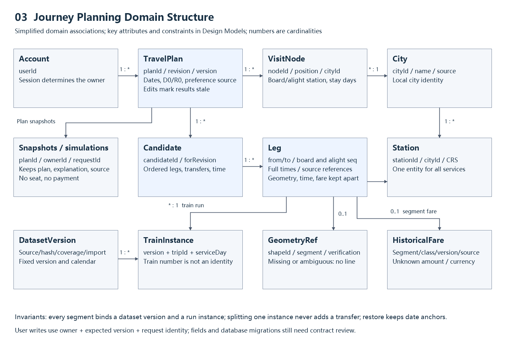
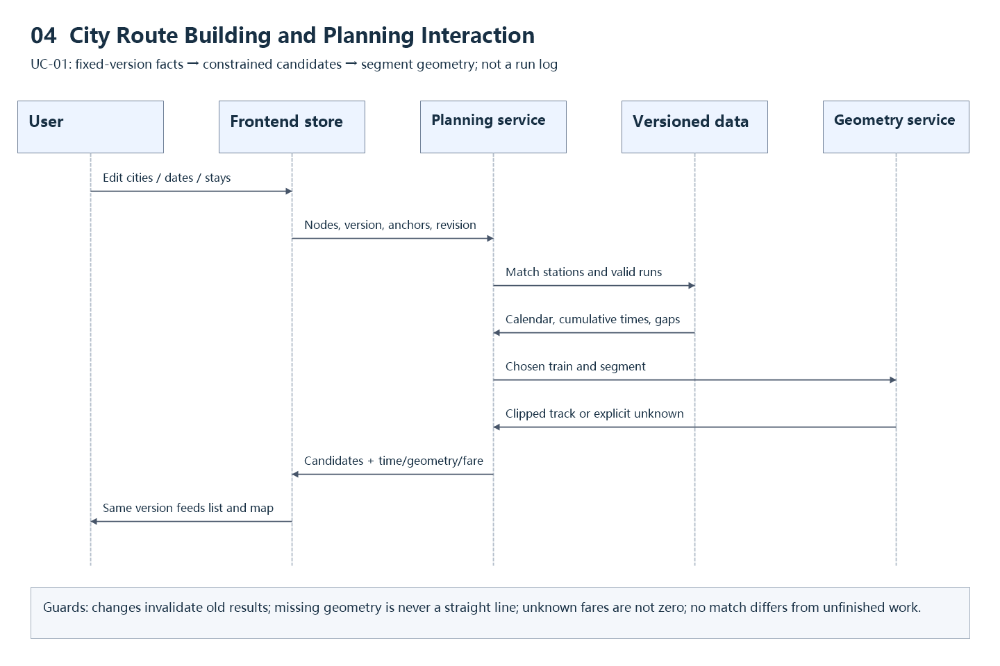
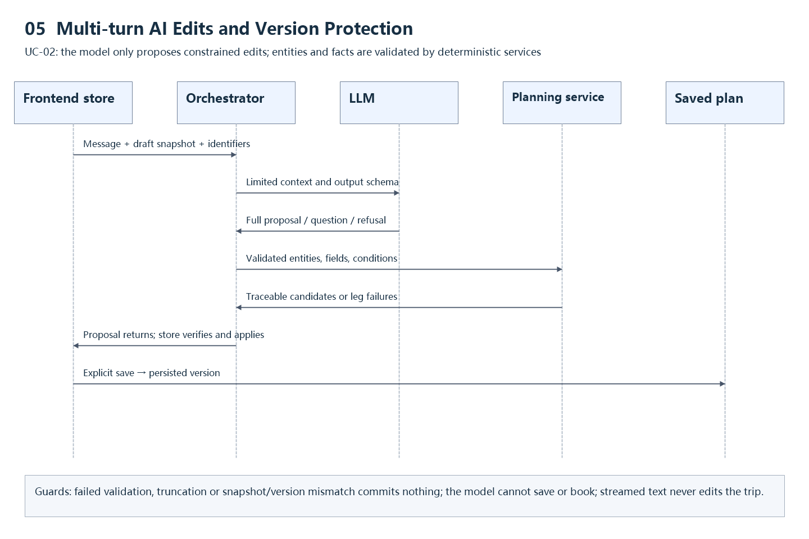

# Design Models and Use-Case Realization

Sihan Li | 2453202 | CD-20261119 | Detailed design, independently reviewed

This draft gives the domain relationships, behavior, and service operations that can guide implementation. The names in the tables are design objects, not generated Java classes or database tables; the tables and HTTP/DTO for this round's import, query, and geometry follow the MVP contract, and the remaining complete product contract still awaits review. Business open items are collected in [Open Issues, Risks and Validation](open-issues-risks.md).

The current MVP takes only the import and geometry parts of this document (§6, §7); scope and acceptance appear in the feature list §2. The remaining use cases are retained as complete product design and fall outside this round's implementation scope.

The current data-quality position follows MVP-C1.2 §3.1: the 193 known source timetable anomalies of the fixed hash are retained at their listed original values with a public warning, and other anomalies still fail hard; activation means that import and anomaly classification are complete, and does not guarantee that all times are correct. Whole-journey connection/transfer remains deferred, and these anomalies cannot be used to claim that connections have been verified.

## 1. Domain and Structural Model

Figure 3: Key entity relationships; [editable SVG](figures/03-domain-model.svg). The small numbers in the figure are association cardinalities, and entity fields appear in the table below.

| Object | Key identifiers/attributes | Responsibilities and constraints |
| --- | --- | --- |
| Account | userId | Owner of itineraries and simulation records; taken from the Session, and the ownerId in a request is not trusted |
| TravelPlan | planId, ownerId, revision, serverVersion, startDate, D0/R0 | Holds ordered visit nodes, the source of preferences, and the current result; the local edit sequence and the server version are kept separate |
| VisitNode | nodeId, position, cityId, arrival/departureStationId, stayDays | Expresses a user visit node; the default stay is a calendar-day stay, and an ordinary train stop does not automatically become a visit node |
| City / Station | Stable ID, attribution, aliases, coordinate system, source | One city to many stations; a concrete station can be referenced by multiple visit nodes, and a station served by both conventional and high-speed trains is not duplicated as an entity |
| Candidate | candidateId, forRevision, datasetVersion, orderedLegs | One candidate under the current conditions; transfers, total duration, and completeness are provided by the server |
| Leg | legId, from/toStationId, board/alightSequence, complete departure and arrival times | A travelled segment; references the train run instance, geometry, and historical segment fare separately, and can express a missing value |
| TrainInstance | datasetVersion + tripId + referenceServiceDate | One identifiable train run instance; the displayed train number cannot replace this composite identity |
| DatasetVersion | sourceURL, hash, coverage, status, importedAt | Fixed GTFS content and operating calendar; the status distinguishes imported from queryable; replacing the version makes existing results pending recomputation |
| GeometryRef | version, shapeId, clipping boundaries, coordinate system, verification | Corresponds to the selected travelled segment; a missing or ambiguous result is not filled in with a straight line |
| HistoricalFare | source version, segment, seat class, currency, amount/null | The price may be unknown; the primary GTFS source does not provide fares, and a segment fare is not manufactured by subtracting full-route prices |
| SavedSnapshot | snapshotId, planId, serverVersion, result and message references | Saves the itinerary, explanation, sources, and anchors at one point in time; user edits cannot rewrite an old snapshot |
| SimulationRecord | recordId, ownerId, requestId, snapshot | An independent simulation record; prominently marked as a simulation, holds no seat and collects no payment, and the recorded snapshot does not change with the plan |

### 1.1 Design Invariants

1. The user's city order and explicit station choices are kept when planning fails; nodes cannot be deleted to obtain a feasible answer.
2. Timetables, geometry, and prices carry status independently; a drawable map does not imply that the timetable is feasible or the price complete.
3. Transfers are counted by changes of adjacent actual train run instances; splitting one instance into display segments adds no extra count.
4. Dates and times are first evaluated on the reference service day and then shifted uniformly to the itinerary date; times beyond 24 hours keep their accumulated days.
5. All saved objects are isolated per user; restore keeps the original version and date anchors and does not remap them to today.
6. A successful update must satisfy `ownerId + planId + expectedVersion`; a conflict keeps the client draft.

### 1.2 Persistence Recommendations

The proposal stores user data in `plans / visit_nodes / plan_snapshots / simulation_records`, and stores stations, train runs, stop times, service days, and track geometry in versioned data tables. Larger shapes can be read by shapeId and version index, without copying nationwide geometry into each itinerary. An itinerary snapshot keeps the necessary segments and source references; before the version deletion/retention policy is settled, no claim may state that old results can be restored permanently.

The proposed unique keys cover the run identity `(datasetVersion, tripId, referenceServiceDate)` and the write-request identity `(ownerId, operation, clientRequestId)`; actual table names, fields, indexes, and migrations go to later review. The user data tables and migrations proposed above are not yet implemented; the MVP schema, nine-file import, and geometry service appear in §6, §7 and the MVP contract, and the two are not conflated.

## 2. UC-01 City Route Building and Historical Itinerary Computation

Figure 4: [editable SVG](figures/04-planning-sequence.svg).

Preconditions are at least an identifiable origin and destination, an itinerary date, and a loaded version; additional conditions are provided through an explicit capability configuration. The main flow is input validation → station candidates → service-day/time matching → cross-segment connection → transfer ordering → segment geometry/price → returned result. A missing price keeps the candidate and marks it unknown; missing geometry keeps the textual result and marks the missing segment.

The proposed search state uses `(visit position, station, reference time, last train run instance)` and expands only along edges that are running and connect in time. The stay constraint of the current visit node is computed from the calendar day of its arrival itinerary, and the search continues after conversion back to the reference day. The priority queue compares transfer counts first; equal counts only keep the output stable, and duration/price are not established as business-level secondary ordering.

At the same visit position, station, and run identity, pruning with a fewer-transfer/earlier-arrival label is allowed only when the remaining feasibility conditions are equivalent; a state that affects calendar-day stays must not be discarded for arriving early. Candidate counts, time windows, and the computation budget are undetermined; budget exhaustion and insufficient data coverage are returned independently and cannot masquerade as "no route in the whole network", and user itineraries cannot be truncated at a fixed transfer count.

### 2.1 Worked Example for Time and Geometry

Given `D0=2026-11-17, R0=2026-11-16`, the offset is 1 day. `26:06:00` on reference service day 11-16 means a reference arrival at 11-17 02:06, and the itinerary displays 11-18 02:06; after a 1-day stay, the earliest itinerary departure date is 11-19, corresponding to reference day 11-18. This example verifies only the date rules and does not claim that an actual train meeting these conditions exists.

For track geometry, first look up the complete shape from `tripId → shapeId` in the same version, then locate the boundaries by boarding/alighting station order and geometric order. When a distance field exists, check its unit and monotonicity; the missing distance field in the specified initial test package is recorded per the source requirement and requires order-based matching. When a fold-back or multiple hits cannot be determined uniquely, return unverified; do not cut shape points directly by stop-array index.

## 3. UC-02 AI Multi-turn Revision of the Same Itinerary

Figure 5: [editable SVG](figures/05-ai-update-sequence.svg).

The user says "via Zhengzhou" on an existing Harbin destination. The frontend packages the current complete conditions into an immutable draft snapshot (`draftId`, `requestId`, `baseRevision`, `baseVersion`, `datasetVersion`, `snapshot`) and sends it with the message, without depending on a plan already saved on the server; the orchestrator loads the snapshot, the LLM returns a structured proposal carrying baseRevision, the validator checks entities and allowed fields, the planning service evaluates under the new constraints, and finally the frontend checks the draft, request, and version before applying the itinerary/explanation/map references atomically once. This modification explicitly requested by the user requires no additional confirmation; an ambiguous "via" stay meaning needs a follow-up question, and a city the model adds on its own is marked as a suggestion.

The proposed result contains `kind, baseRevision, operations, suggestions, clarification, candidateRefs`; it is a course-internal design shape, not a vendor interface already connected. Only a complete proposal can enter validation. A timeout, refusal, truncation, or Schema failure keeps the input and the old itinerary; reply text may be kept, but unvalidated itinerary facts must not be committed together with it.

If the user changes the date while waiting and the revision has changed, the old AI return cannot be applied; recomputation is prompted. Streaming text updates only the message display and does not change the city array character by character. The map, the list, and the saved version reference the same result version. Application rules for the four cases — a first unsaved draft, a local edit after save, another edit while waiting, and a switch of itinerary or identity — appear in [Architecture §5.1](architecture.md#draft-protocol).

## 4. UC-03 Save, Conflict, and Restore

A save first completes the identity check and captures an immutable `revision + baseVersion + clientRequestId`; one save request per plan at a time, while editing remains possible during the save. The server validates the owner, version, snapshot, and request deduplication within a short transaction, and on success returns the planId, serverVersion, and the result for the corresponding request.

When a save returns, only the submitted revision is recorded as savedRevision; newer edits remain marked unsaved. A cross-window version mismatch returns a business conflict; the user can view the latest, save a copy, or continue editing, and silent overwrite is not allowed. A write-request timeout enters unknown; work continues only after the result is checked with the original clientRequestId, avoiding duplicate records caused by switching the request ID.

Restore re-validates the owner, reads the plan and version anchors, and discards old in-flight requests; if the source is unavailable or the version has changed, it shows the saved snapshot and marks it as requiring recomputation. The complete save capability differs from the current localStorage draft, which stores only cities and dates.

## 5. State Model and Service Operations

| State set | Transitions and triggers | Retention conditions |
| --- | --- | --- |
| Planning `idle/loading/ready/partial/empty/error/stale` | Condition change → stale; query → loading; result, partial gap, no match, and failure return separately | ready does not erase unknown segment prices; an old request does not change the new state |
| AI `idle/streaming/validating/applied/clarification/error` | Validate after the text stream completes; applied only when the version matches | clarification/error does not clear manual input |
| Save `dirty/saving/saved/conflict/unknown` | Conditional version and result check decide the next step | A newer draft cannot become saved because an old save succeeds |
| Import `idle/importing/validating/active/failed` | Activate only after validation passes; a failure keeps the previous version available | An inactive version serves no queries; re-importing the same version does not regenerate data |

| Internal operation | Required input | Output and exception semantics |
| --- | --- | --- |
| `getPlanningContext` | user/version context | Available sources, capability fields, date anchors, or an explicit unknown |
| `searchPlaces` | query, source scope | Candidates with stable identity; POI quota/no result is distinguished from a local failure |
| `planJourney` | nodes, startDate, version, anchors, revision | Candidates, per-segment fact status, and reasons for no match/coverage/incompleteness |
| `applyAiProposal` | `draftId`, snapshot (ordered nodes/date anchors/preferences/candidate references), `requestId`, `baseRevision`, `baseVersion`, `datasetVersion` | A follow-up question or a validated candidate patch; reads or writes no persisted itinerary, and no commit occurs on a refusal or a snapshot/version mismatch |
| `savePlan` | snapshot, baseVersion, clientRequestId | Save result, conflict, or unknown result pending verification |
| `getWriteResult` | user, clientRequestId | The original write result or still unconfirmed; this cannot be used to bypass the owner |
| `restorePlan` | user, planId | A complete restorable snapshot; other users' objects are unreadable |
| `createSimulation` | user, candidateSnapshot, clientRequestId | A simulation record deduplicated by the same ID; involves neither payment nor seat inventory |
| `importDataset` | fixed package source, expected hash | Import report and version status; a validation failure does not activate and does not overwrite the version in use |
| `listSegmentTrips` | origin/destination station `stop_id`, dataset version, original reference service day; per confirmed OPEN-16, an in-package date can be selected, with the default day returned by context | List of direct services on the same train; no direct service and no service on that day are returned separately, and transfers are not used to fill the gap |
| `getSegmentGeometry` | train run, boarding/alighting station `stop_id`, dataset version | Clipped segment track geometry and coordinates, verification status; a missing shape or non-unique boundary returns unavailable |

The public HTTP contract continues to use `/api`, Session, and the unified error body; 409 indicates a business conflict, and 422 indicates a parse/validation failure. This round's concrete paths, status codes, and DTOs appear in the MVP contract; public historical data is read-only, with no user write or administrator interface. The remaining complete product contract is reviewed later, and frontend live placeholder paths are not claimed as an established backend contract.

## 6. Data Import

Import turns a fixed GTFS package into queryable versioned data and is the common precondition for segment track geometry and later planning. The flow is: obtain the fixed package → validate (hash, required files, foreign keys, date coverage) → load in batches → register the version → activate → output the import report. The whole package is imported, without first trimming a sample subset.

| Stage | Requirement |
| --- | --- |
| Version registration | Record source, hash, coverage dates, import time, and status; re-importing the same version does not regenerate data |
| Activation | Only a version that passes validation is queryable; a failed version is not activated, and the version in use stays available |
| Scale | Batch writes with indexes by train run, station, and shape; nationwide shapes are not sent to the browser |
| Failure semantics | Missing files, foreign-key inconsistency, and out-of-range dates are reported separately; partial success does not mean the import is complete |
| Licensing | Retain upstream author, source, version, and CC BY 4.0 attribution |

Proposed tables (names pending review): `dataset_version`, `gtfs_stop`, `gtfs_trip`, `gtfs_stop_time`, `gtfs_service_date`, `gtfs_shape_point`. Station-to-city attribution, aliases, and service tags are still added separately under OPEN-07 and are not inferred from station names during import.

Only after import activation are station search, train stop sequences, complete timetables, and service-day queries provided; an inactive version must not be referenced by geometry or itineraries. The `DatasetVersion` status and record counts distinguish "imported" from "queryable"; they are not the same thing.

MVP station candidates display the station name and `stop_id`; station selection and segment queries associate by `stop_id`, and details display the station IDs at both ends. Per confirmed OPEN-16, a reference service day within the package can be selected, defaulting to 2026-11-16; times are evaluated directly on the original reference service day, and the D0/R0 offset is deferred. Complete nine-file loading, batch import/activation/retry, fields/indexes, and read-only HTTP are implemented per the MVP contract.

## 7. Segment Track Geometry

The input is the boarding/alighting station `stop_id` on the same train run; the output is the actual railway track geometry of that segment for map drawing, and it does not cover transfer stitching.

1. Take the same-version `shape_id` from `trip_id`, read ordered points by `shape_pt_sequence`, and do not stitch across versions.
2. Locate the boarding/alighting boundaries along the shape order using the coordinates of the two stations, and clip the travelled segment. This package has no `shape_dist_traveled`, so the point array cannot be cut by stop-order index.
3. When the boundary is unique, return the clipped polyline and the verification status; when a fold-back, repeated passage, or multiple hits make it non-unique, return unavailable and do not fill in a straight line.
4. Backend matching and the response keep WGS84; only the frontend Amap adapter converts to GCJ-02 before drawing, and the conversion happens once. The 200m projection tolerance, order matching, and ambiguity determination follow the MVP contract; failures are not bypassed by hard-selecting the nearest pass or by raising the tolerance.
5. One shape can be shared by multiple train runs and cached by version and segment; the frontend receives only the clipped result.

Acceptance rests on segment-by-segment comparison with the real railway alignment using fixed samples; "having a shape_id" or a synthesized polyline does not count as passing.

Implementation status as of 2026-11-19: §6 and §7 are implemented per the MVP contract; the whole-package import of the fixed package, direct services, stop details, and segment track geometry have all passed independent review and user acceptance; cross-browser/real-device checks, concurrency stress, and full re-import are untested. The remaining use cases in this document (§2–§5) remain complete product design and are not yet implemented.
