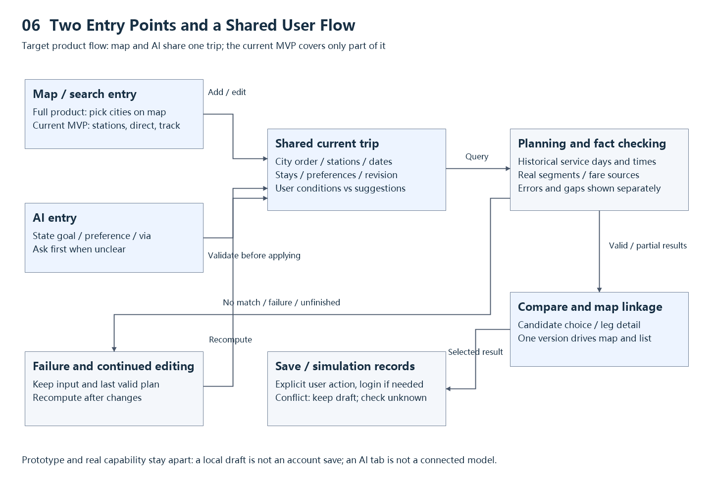
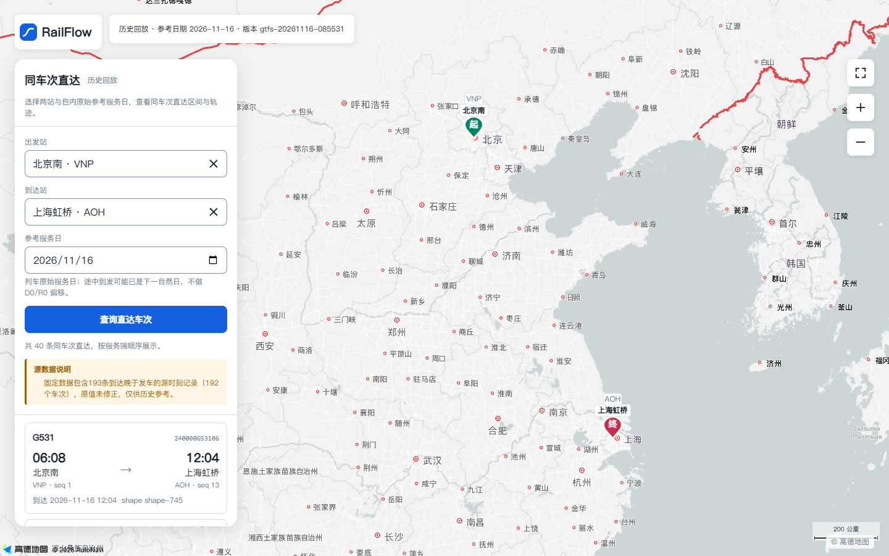
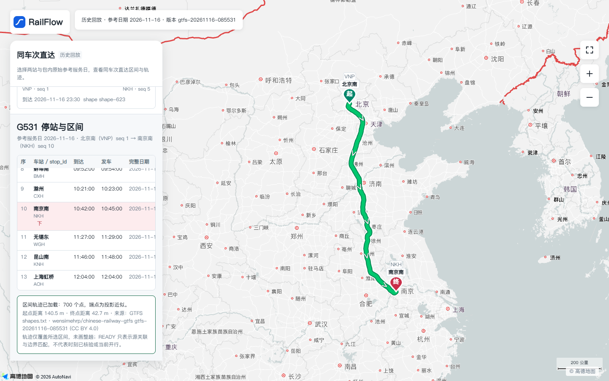
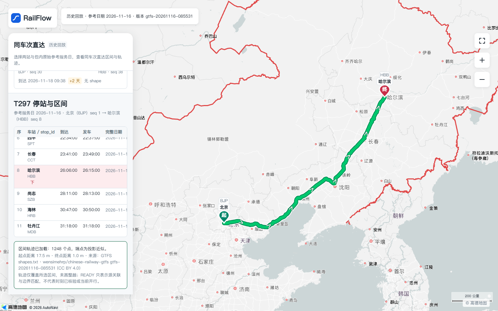
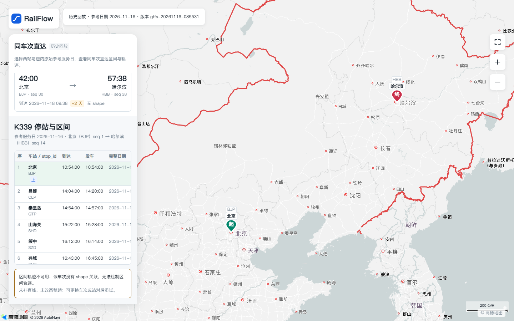
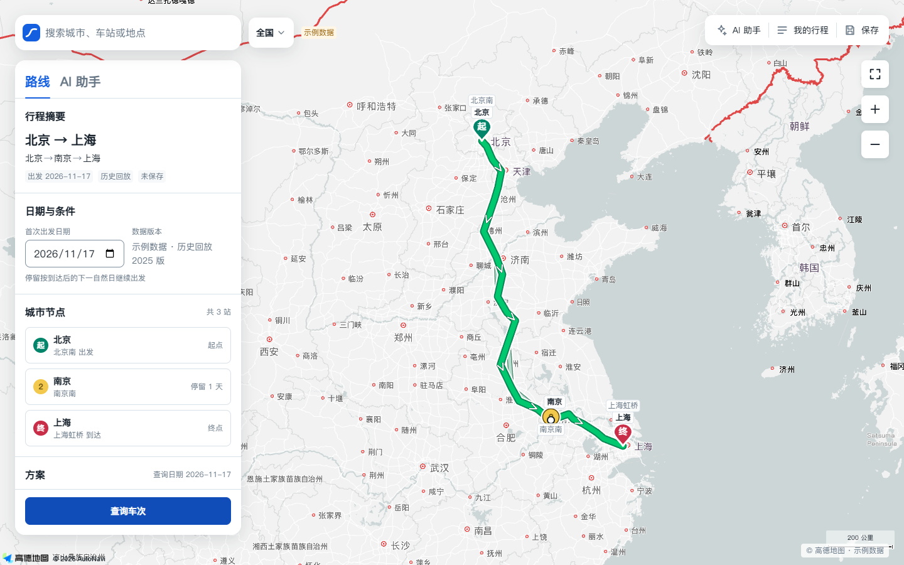
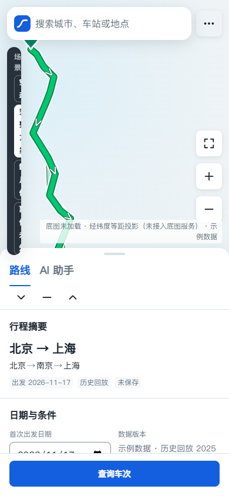
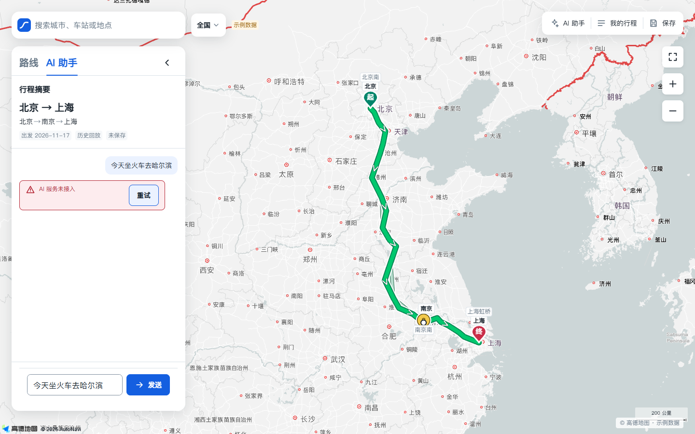

# UI and UX Design

Sihan Li | 2453202 | CD-20261119

## 1. Information Architecture and Key Choices

The map is the primary workspace; the search box at the upper left handles city/station disambiguation and adds places to the itinerary, and a single panel on the left reuses its space across "Route / AI Assistant / My Trips". The route panel shows, in order, the summary, the dates and conditions, the city nodes, the candidates, and the query action, while the save entry points are concentrated in the top bar. The conversation and the map share the current itinerary, and switching tabs never creates a second city list.

The 1440×900 desktop design uses a 360-wide panel, a 360×56 search box, and 24 outer margins, targeting about 60% of the screen as an unobstructed map. Mobile uses a bottom drawer and fixed primary actions, and input can still be completed after the on-screen keyboard appears. Necessary help expands on demand, and source notes and missing-data explanations stay close to the content they concern.

The above is the complete product structure for a multi-city itinerary. After the scope converged under [requirements §2.1](requirements-update.md#scope-boundary), the implemented interface keeps only the historical replay of direct service on the same train: the search box, the origin and destination stations, the reference service day, the query action, the train list, the stop table, and the segment map; the AI tab, My Trips, multi-city editing, and multi-plan comparison are no longer mounted. The interface is organized so that it shows what has been selected, and unimplemented entry points carry no decorative buttons.

## 2. User Flows

Figure 6: [editable SVG](figures/06-user-flow.svg). Solid lines show the target main flow; the exception boxes show the recovery paths that retain input, and the diagram is not a run-test result.

- Map entry: select a city → disambiguate/match stations → edit order/date/stay → query reference plans → compare and view segments → save or write a simulation record.
- AI entry: enter an intent → inherit the current conditions or ask a follow-up question → state the suggestion and the user's conditions → tool verification → update the same plan and map.
- Save: open sign-in in place when identity is required, and after a successful sign-in, verify the owner and the pending snapshot before continuing; a conflict is not overwritten, and an unknown result is verified first.
- Unable to plan: identify the affected segments, keep the cities, dates, and the previously valid plan, and let the user adjust; do not delete cities unilaterally.

The same-train replay implemented in this round follows a narrowed version of the main flow above: select stations and the reference service day → query direct services → select a train → view stops and segment track geometry; no match, no service on that date, outside coverage, and unavailable track geometry each give their own reason, and the station pair and train already selected by the user are retained.

## 3. Core Result States (Implemented MVP, Real Data)

The four images in this section are live captures from the local `web` deployment at 2026-11-20 00:18 (corresponding to the implementation and acceptance state of 11-19): the same Spring Boot process hosts the frontend and connects to the fixed GTFS package in a real MySQL instance (version `gtfs-20261116-085531`, reference service day 2026-11-16), over a real Amap basemap. The screenshots are saved as-is at the 1440×900 viewport, uncropped and with no text altered; the short in-image label "historical replay · reference date · version" and the Amap attribution remain visible. The running interface is in Chinese, so the screenshots carry Chinese labels while captions and this document are in English. In each capture, the partly visible candidate card above the panel is the last item of the candidate list, not the selected train.

### 3.1 Candidate Result List

Figure 7: Beijing South (VNP) → Shanghai Hongqiao (AOH), with 40 direct services on the same train shown in server order. The first entry, G531, shows the departure and arrival times, station codes, travelled segment, and the full arrival date; a fixed "historical replay · reference date · version" short label sits at the top, and a source-data note appears above the list (the 193 records in the fixed package whose arrival is later than departure are kept at their original values). The map marks the origin and destination and draws no polyline until a train is selected.

### 3.2 Selected Train, Stops, and Segment Track Geometry

Figure 8: G531 selected for Beijing South (VNP) → Nanjing South (NKH). The train has 13 stops over its full run, and this round takes only seq 1 → seq 10; the panel gives the reference service day and the boarding and alighting stop sequence numbers, and the stop table lists station name, station code, arrival, departure, and full date, with the boarding station in green and the alighting station in red. The map draws only the clipped track geometry of that segment (700 points), with the start 140.5 m from Beijing South and the end 42.7 m from Nanjing South, and it does not extend to the later Wuxi East and Shanghai Hongqiao; source and CC BY 4.0 attribution are annotated. `READY` means only that the track geometry is linked and the boundaries match; it does not mean the times have been verified or that the service currently operates.

### 3.3 Times Across Midnight

Figure 9: T297 selected for Beijing (BJP) → Harbin (HBB), with the segment spanning seq 1 → seq 8. Arrival/departure shows `26:06 / 26:15`, and later stops continue accumulating to `31:18`, demonstrating that times beyond 24 hours are kept as cumulative values instead of being truncated to an ordinary clock time. The figure also shows that the "reference service day" and the "user's itinerary date" are two distinct things: the times shown are full times on the reference service day and do not yet add the itinerary date.

### 3.4 Track Geometry Unavailable and Retained State

Figure 10: K339 is selected for the same station pair, and this train has no shape association. The panel shows "segment track geometry unavailable" with the reason, and the map draws no polyline, adds no straight line, and does not redraw the whole run; the station selection, the train, and the textual result are all retained, and the user can change the train or the station pair and retry. This is the concrete interface evidence in this round that a missing result is not masked by another kind of success.

Note: inside the 360-wide panel, the "full date" column of the stop table can be viewed by scrolling horizontally; this round's MVP does not implement fares, so the interface shows no price and places no "price unknown" placeholder, which avoids drawing an unimplemented capability as implemented. States of the full product such as an unknown fare and a save conflict appear in §5.

## 4. Target-State Prototypes of the Full Product (Interface Design Reference)

The following three figures come from the 2026-11-17 version of the interface, copied unchanged and uncropped, and they convey multi-city route building, the mobile drawer, and the AI-not-connected state of the full product. That version of the interface later converged to the MVP scope, and the AI assistant, My Trips, multi-city editing, and multi-plan comparison are not mounted in the current implementation; these three figures therefore serve only as an interface design reference for the full product, must not be read as the currently implemented interface, and must not be used to conclude that AI or account saving is connected.

### 4.1 Desktop Route-Building Workspace

Figure 11: a 1440×900 map, three city nodes, calendar-day stays, and the query action. It illustrates the spatial organization and route presentation of the full product; the lines and the "sample data" and "2025 edition" labels in the image belong to the synthetic fixtures of that time.

### 4.2 Mobile Bottom Drawer

Figure 12: a 390×844 half-expanded drawer with the query action at the bottom, showing basemap degradation and the scenario controls. It does not demonstrate soft-keyboard behavior or touch hit targets on real devices, which remain subject to device verification.

### 4.3 AI Not Connected and Recovery

Figure 13: input retained, an explicit "AI service not connected" message, and a retry entry point, as a reference for exception-interaction design. The multi-turn valid-proposal states of the product AI appear in [architecture §5](architecture.md) and Figure 5.

## 5. States and Recovery Actions

| State | Display | User's next step |
| --- | --- | --- |
| Initial/loading | No submission while required fields are unmet; loading has placeholders and feedback | Continue editing; cancel the previous computation |
| No match/date not covered | Mark the affected segments and the reasons, distinguished from a network failure | Change the date, stations, or conditions |
| Missing geometry | No line is drawn for that segment, and stops and textual results are retained | Inspect known facts or recompute; no schematic line is used to stand in for a real route |
| Fare unknown | Show unknown with the number of missing segments; the known subtotal is not called a total price | Keep the plan; unknown is not treated as zero or as meeting the budget |
| Conditions changed | Old results are marked for recomputation, and map and list stay consistent | Query the new conditions; late results do not overwrite |
| AI/POI/basemap failure | Each failure is reported separately, and input and valid plans are retained | Build the route manually, retry, or inspect valid data |
| Save conflict/unknown result | Local draft retained and a verify action shown | View the latest/save as new/continue editing; for an unknown result, check the original request first |

Dates state the itinerary day explicitly in Beijing time, and the historical replay label and the source version are inspectable; no "tickets available / no tickets / on sale" promise appears. Adjacent candidates are distinguished by number, line style/weight, and redundant text, never by color alone.

## 6. Accessibility and Follow-up Verification

Search is not submitted while the input method is composing, and candidates are selectable from the keyboard; primary buttons should provide a 44×44 tap area, visible focus, and a clear readable name. Only genuinely modal dialogs trap focus, and focus returns to the trigger on close; hidden panels leave the navigation order. At 200% zoom and 320 width, long station names do not obscure actions, and the reduced-motion setting is respected.

The implementation in this round did not run a separate full keyboard flow on the MVP shell or device-level acceptance at 390/320; the keyboard and narrow-screen records of the 11-17 frontend serve only as historical reference and cannot establish the converged interface. Firefox/Safari, physical iOS/Android devices, the soft keyboard, and map gestures remain unverified; subsequent work records the operation, expected versus actual result, screenshots, dataset version, and uncovered items on fixed devices to form an independent conclusion.
