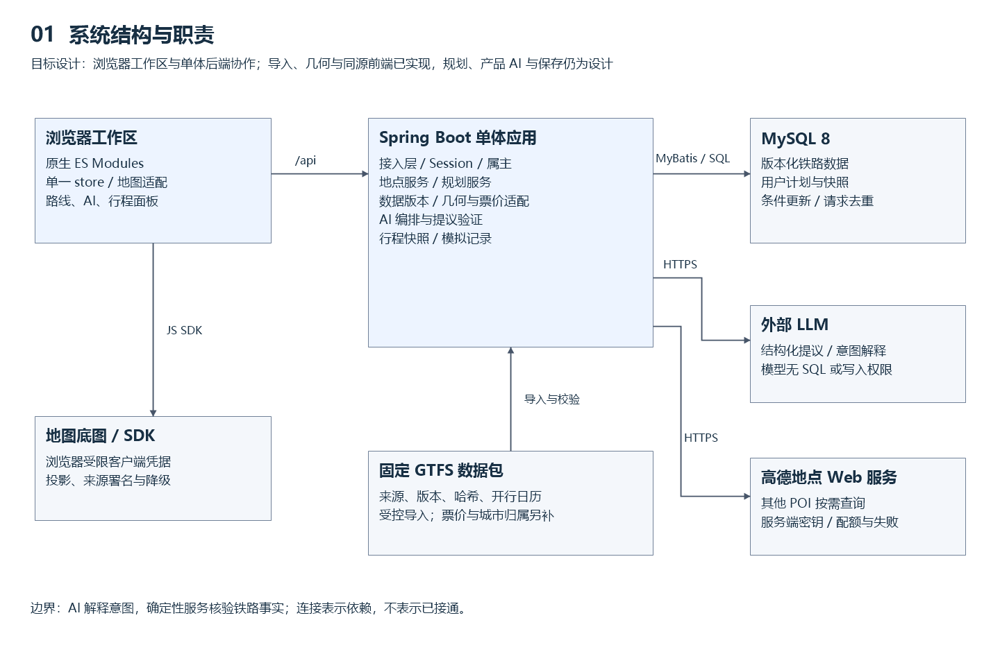
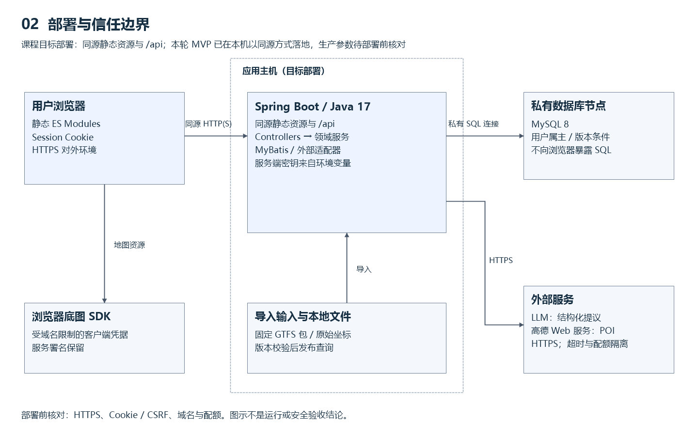

# 架构与关键决策

李司翰｜2453202｜版本 CD-20261119｜课程设计稿，已独立复核

## 1. 问题与边界

系统要解决有序城市、铁路时刻、自然日停留与地图轨迹之间的一致性问题。生成式模型负责意图解释，铁路可行性由版本化数据和确定性计算负责。几何、时刻和价格独立表达可信程度，任何一种缺失都不会被另一种“成功”掩盖。

已确认的产品范围见本交付内的[更新需求](requirements-update.md)。本轮 MVP 的导入、几何与同源前端已经实现并通过验收；完整产品的规划、产品 AI 与保存仍为设计，范围与退出条件见[需求 §2.1](requirements-update.md#scope-boundary)。沿用既有技术选择，新增模块划分、内部操作和验证参数中已实现部分以 MVP 契约为准，未实现部分仍为设计建议，不作为已定稿 API 或新业务规则。

## 2. 系统级与逻辑视图

图 1：目标系统的容器与主要职责；[可编辑 SVG](figures/01-system-architecture.svg)。图中连接表示设计依赖，不表示服务已接通。

| 模块 | 输入与输出 | 责任边界 |
| --- | --- | --- |
| 浏览器工作区 | 城市/车站、日期、偏好 → 地图、候选与解释 | 单一 store；仅经数据适配器访问业务数据；当前夹具模式保留明显样例标识 |
| 接入层 | 受校验请求 → 统一结果/错误 | 参数、Session、属主、请求标识；组件不拼装业务 SQL |
| 地点服务 | 文本/实体 ID → 本地城市、车站或外部 POI | 区分城市和车站身份；高德结果不能直接作为铁路站码 |
| 规划服务 | 有序节点、版本与条件 → 候选及失败原因 | 车站匹配、服务日、衔接、换乘计数、失效传播；不让模型计算票务事实 |
| 数据与几何服务 | 固定 GTFS、运行实例与区间 → 可追溯时刻/轨迹 | 校验外键和日历，按顺序裁剪 shape，保留原始 WGS84；历史票价独立适配 |
| AI 编排服务 | 消息与行程快照 → 补问/受校验修改/解释 | 工具白名单、结构校验、版本检查及有限调用；无 SQL 或交易权限 |
| 行程服务 | 用户、快照、版本、请求 ID → 保存/恢复结果 | 属主隔离、条件更新、幂等核对、模拟记录快照；与规划计算分离 |
| MyBatis 与外部适配器 | 领域查询/写入 → 数据或明确异常 | 参数绑定与环境变量；不将原始上游消息直接展示给用户 |

模块位于同一个 Spring Boot 应用，先采用普通方法调用。当前课程规模无需微服务、消息队列、向量数据库或额外缓存基础设施。导入与在线规划分离；外部 LLM 调用期间不持有数据库写事务。

## 3. 部署视图

图 2：[可编辑 SVG](figures/02-deployment.svg)。

建议课程部署由同源 Spring Boot 托管静态前端及 `/api`，连接私有 MySQL；固定 GTFS 包先经受控导入，再提供查询。浏览器按 SDK 规则访问底图服务，普通地点 Web 服务与 LLM 经后端调用。该形态已在本地以 `web` profile 落地：同一个 Spring Boot 进程挂载 `src/frontend` 与 `/api`，连接私有 MySQL 8，浏览器加载高德底图。证书、域名、账号配额与生产环境参数仍待部署前核对，本地演示使用回环地址。

部署保留 Java 17 与 Maven 构建；不要求运行上游 Python 采集器，也不把全国 shapes 发送给浏览器。对外环境配置 HTTPS、Cookie 的 HttpOnly/Secure/SameSite、CSRF 防护与允许的来源；本地演示使用回环地址。实际证书、域名和账号配额在部署前核对，不将图示等同于部署完成。

服务端密钥从环境变量读取；浏览器地图 SDK 使用受域名限制的客户端凭据，不能复用服务端 Web 服务或 LLM 密钥。日志只记请求标识、版本、耗时和归一化错误，不记录密码、完整对话或密钥。

## 4. 技术视图与决策理由

| 决策 | 采用/沿用 | 比较过的替代 | 理由与后果 |
| --- | --- | --- | --- |
| T01 应用边界 | Java 17 + Spring Boot 3 单体；沿用 ADR-001 | 新语言后端、微服务 | 保留团队技术积累，避免增加部署单元；模块边界用接口和职责表达 |
| T02 持久化 | MySQL 8 + MyBatis；沿用 ADR-002 | 全部 localStorage、通用 ORM | 版本、属主和条件写入需数据库保证；显式 SQL 易检查，迁移与索引需另验 |
| T03 前端 | 原生 ES Modules；沿用 ADR-006 | Vue/React 重写 | 现有工作区可复用，不新增构建步骤；请求有效性集中在 store/适配器 |
| T04 身份 | Session + Cookie；沿用 ADR-007 | JWT | 同源课程系统无需额外令牌管理；必须实现 CSRF 与会话过期恢复 |
| T05 铁路输入 | 固定 GTFS 包与关联 shapes；需求 C28–C30 | 实时票务 API、AI 生成线路 | 来源和日期可追溯，符合预算；票价与城市归属需补，数据存在不等于几何正确 |
| T06 产品 AI | 受控编排 + 结构化修改；详细设计建议 | 单次槽位预填、模型自主执行任意工具 | 支持多轮同时限制动作；保留工具事实与用户条件，复杂度转移到验证与版本控制 |
| T07 地点分工 | 本地城市/站点 + 高德其他 POI；需求 C27 | 全量 POI 抓取、POI 直接作铁路实体 | 减少数据维护，避免身份混淆；完整产品 POI 配额等仍待落实。本轮底图沿用高德 JS API 2.0 适配方向，前端唯一转换坐标，按 MVP 契约实施；真实加载与三组样例车次的走向核对已完成，POI 查询仍未接入 |
| T08 保存 | 用户快照 + 条件版本 + 请求 ID；详细设计建议 | 覆盖式保存、仅禁用按钮 | 防止跨窗口覆盖和超时重复写；结果未知时需原请求核对接口 |
| T09 产品 AI 模型 | 外部 LLM 经 OpenAI 兼容接口调用，按 JSON Schema 返回结构化提议；本机不部署模型 | 本地小模型、规则式意图解析、单次槽位预填 | 结构化输出便于校验、拒绝与截断处理；本地模型省外部依赖，但中文改线质量与显存未验证；具体供应商与模型版本留待 PoC 选定，不写死为已定稿 |

旧 ADR-003/004/008 的库存、订单超时与活跃订单唯一性不适用于当前规划主线。T06 扩展了旧 ADR-005“仅预填”的产品范围；这是根据已确认多轮需求提出的替代设计，仍需评审，不回改历史 ADR。

## 5. 产品 AI：角色、工具、状态与护栏

采用一个受控编排器协调 LLM 与领域服务，无需先实现多个自主模型智能体。开发过程的决策/search/开发/review 角色不进入产品运行图。

| 角色/操作 | 输入 → 输出 | 约束 |
| --- | --- | --- |
| LLM 意图解释 | `message + draftSnapshot` → `clarification / proposal / explanation` | 所有提议带 baseRevision 与快照指纹；不输出可售承诺 |
| `resolvePlaces` | 文本、允许城市范围 → 有来源实体候选 | 歧义交用户或明确标注建议；不接受模型自造站点 ID |
| `planJourney` | 有序节点、日期锚点、数据版本、明确条件 → 候选/分段失败 | 调用确定性规划服务；不能将部分可行表述为全程可行 |
| `describeCandidate` | 经核验候选 ID → 来源化摘要 | 只解释已取得事实；票价未知保持未知 |
| 行程修改提交 | `draftId + requestId + baseRevision + 允许字段补丁` → 新 revision | 一次原子提交；不写任意对象路径，不改变已明确条件之外的字段 |

### 5.1 草稿快照与版本应用协议

用户可能在未保存的计划上直接对话，也可能在等待模型返回时继续改日期。行程的当前完整状态在浏览器 store 中，服务端只在保存后持有持久化版本，"按 planId 读取上下文"覆盖不了这两种情况。协议因此改为：**请求携带不可变草稿快照，服务端只计算提议，前端在真实状态所有者处做一次条件应用。**

请求体包含 `draftId`、`requestId`、`baseRevision`、`baseVersion`（未保存时为 null）、`datasetVersion` 与 `snapshot`。`snapshot` 是当前完整条件的不可变副本：有序访问节点、日期锚点、明确偏好、已选候选引用与锚点来源；不含历史消息全文。`draftId` 由客户端生成，首次未保存的计划即可使用，保存成功后与 planId、serverVersion 绑定。服务端只做身份与字段合法性校验，按快照计算，不写行程。

前端收到提议后核对 `draftId`、`requestId`、当前 `revision`、`datasetVersion` 与快照指纹全部一致，才把补丁原子应用一次；任何一项不符，只保留解释文字并提示重算，不改行程。四类情况分别走通：

1. **首次未保存草稿**：没有 planId，服务端纯计算，不要求先登录或先保存；用户确认后再决定是否保存。
2. **已保存后本地编辑**：快照携带 r+1 的条件、`baseVersion` 仍为上次保存版本；提议只对 r+1 生效，保存冲突仍按 UC-03 处理。
3. **等待中再次编辑**：current 已到 r+2，迟到提议的 baseRevision 为 r+1，不应用，只显示说明。
4. **切换行程或身份**：draftId 或所有者范围不符，直接丢弃结果。

该协议不新增服务端草稿表：草稿仍留在浏览器，跨设备草稿与长期偏好属未决范围。**记忆边界**：工作记忆只有本次请求的草稿快照与当轮消息，服务端不保存聊天历史、不据此建立用户画像；长期偏好与跨行程记忆后置。模型返回的 `setDate / insertVisit / replaceDestination / setPreference` 等动作先过白名单、类型、实体、顺序与版本校验；删除和修改只作用于用户授权字段。

用户明确说“加入郑州”可授权此次修改；模型自行建议乌鲁木齐需标为建议并允许纠正。补问、模型拒绝、截断和非法结构均不能提交半个补丁。用户在等待中手动改线时，旧结果仅保留说明并提示重算，不能覆盖新地图。

调用预算和超时为可配置的技术保护，具体值经 PoC 决定。达到预算返回“计算未完成”及可继续动作，不返回假的“无路线”。工具参数拒绝任意 URL/SQL，外部返回按不可信数据处理；模型不能调用保存、模拟预订或其他写操作。保存与模拟记录由用户界面明确触发、服务端鉴权。

## 6. 质量属性与验证

| 属性 | 优先级 | 设计支持与验收目标 |
| --- | --- | --- |
| 数据正确性 | 最高 | 逐段绑定数据版本、运行实例、服务日和区间；缺失状态可追溯；用基准算例比较 |
| 状态一致性 | 最高 | revision + requestId + 用户/计划/版本共同校验；同一结果同时驱动地图和列表 |
| 安全/隐私 | 高 | Session 属主、参数绑定、CSRF、环境变量、工具白名单；以跨用户访问与非法补丁测试核验 |
| 可恢复性 | 高 | 本地输入和旧有效方案保留；AI/POI/底图失败分别降级；保存未知结果先核对 |
| 性能/可维护性 | 高 | 固定版本预处理与索引、按区间发送几何、有限搜索和取消；不靠截断用户节点隐藏负载 |
| 可解释性 | 高 | 用户条件、模型建议和工具事实分开；明确历史回放、未知票价与缺几何 |

性能数值尚不是已确认产品承诺。本稿建议 PoC 先在固定设备、固定数据与 3 城市样例上记录规划 P50/P95、节点扩展数和响应几何大小，再确定预算；基础界面目标与无障碍条件见[UI/UX](ui-ux.md)。风险、方法与通过判据见[风险记录](open-issues-risks.md)。

技术资料：[C4 分层图](references.md#ref-c4)、[Spring Boot](references.md#ref-spring)、[MyBatis](references.md#ref-mybatis)、[InnoDB](references.md#ref-mysql)、[结构化输出](references.md#ref-openai)。
