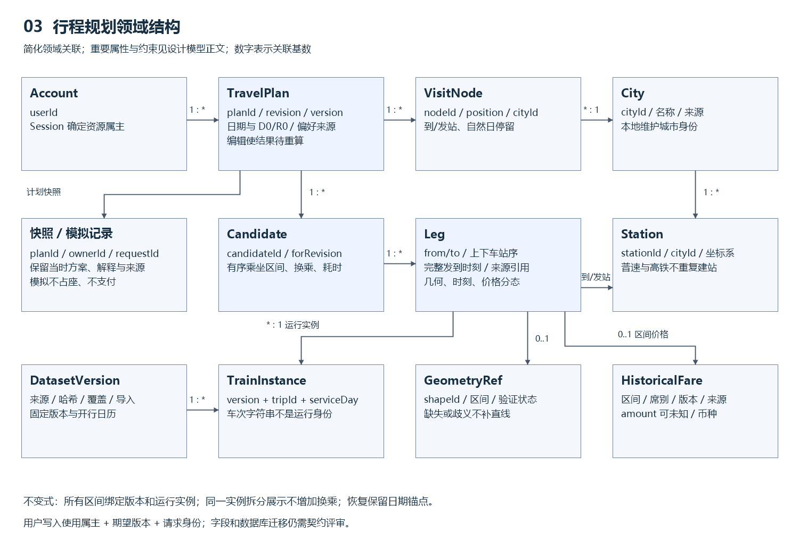
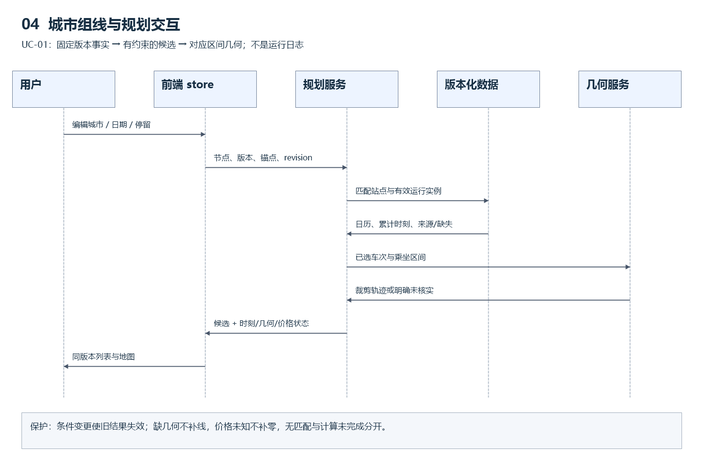
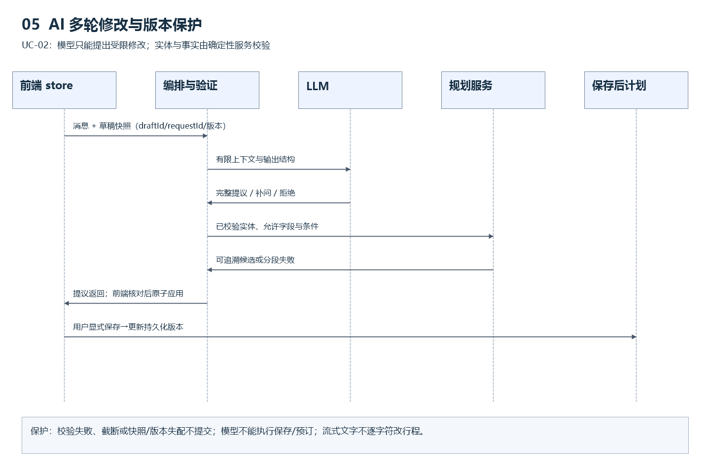

# 设计模型与用例实现

李司翰｜2453202｜CD-20261119｜详细设计，已独立复核

本稿给出可指导实施的领域关系、行为与服务操作。表中名称是设计对象，非已生成的 Java 类或数据库表；本轮导入/查询/几何的表与 HTTP/DTO 以 MVP 契约为准，其余完整产品契约仍待评审。业务未决项集中在[风险与未决问题](open-issues-risks.md)。

当前 MVP 只取本文的导入与几何部分（§6、§7），范围与验收见功能清单 §2；其余用例保留为完整产品设计，不属本轮实施范围。

当前数据质量口径以MVP-C1.2 §3.1为准：固定哈希的193条已知源时刻异常按逐条清单原值保留并公开警告，其他异常仍硬失败；激活表示导入和异常分类完成，不保证全部时刻正确。全程衔接/换乘仍后置，不能把这些异常用于宣称已验证可衔接。

## 1. 领域与结构模型

图 3：关键实体关系；[可编辑 SVG](figures/03-domain-model.svg)。图中小数字为关联基数，实体字段详见下表。

| 对象 | 关键标识/属性 | 职责与约束 |
| --- | --- | --- |
| Account | userId | 行程和模拟记录的属主；从 Session 获取，不信任请求中的 ownerId |
| TravelPlan | planId、ownerId、revision、serverVersion、startDate、D0/R0 | 持有有序访问节点、偏好来源和当前结果；本地编辑序号与服务端版本分开 |
| VisitNode | nodeId、position、cityId、arrival/departureStationId、stayDays | 表达用户访问节点；默认自然日停留，列车普通经停不自动成为访问节点 |
| City / Station | 稳定 ID、归属、别名、坐标系、来源 | 城市 1 对多车站；具体车站可被多个访问节点引用，普速/高铁兼有服务不重复建实体 |
| Candidate | candidateId、forRevision、datasetVersion、orderedLegs | 当前条件下的一个方案；换乘、总耗时与完整性由服务端提供 |
| Leg | legId、from/toStationId、board/alightSequence、完整发到时间 | 乘坐区间；分别引用运行实例、几何与历史区间价，可表达缺失 |
| TrainInstance | datasetVersion + tripId + referenceServiceDate | 一次可识别的运行实例；展示车次名不能替代此复合身份 |
| DatasetVersion | sourceURL、hash、coverage、status、importedAt | 固定 GTFS 内容与开行日历；状态区分已导入与可查询；更换版本使既有结果待重算 |
| GeometryRef | version、shapeId、裁剪边界、坐标系、verification | 对应已选乘坐区间，缺失或歧义不补直线 |
| HistoricalFare | 来源版本、区间、席别、currency、amount/null | 价格可能未知；GTFS 主源不提供票价，不用全程价相减制造区间价 |
| SavedSnapshot | snapshotId、planId、serverVersion、结果及消息引用 | 保存同一时点的行程、解释、来源与锚点；用户编辑不能改写旧快照 |
| SimulationRecord | recordId、ownerId、requestId、snapshot | 独立的模拟记录；显著模拟标识，不占座、不收款，记录后快照不随计划改变 |

### 1.1 设计不变式

1. 用户城市顺序和明确车站选择在规划失败时保持；不能删节点来得到可行答案。
2. 时刻、几何和价格独立携带状态，不能由地图可画推导时刻可行或价格完整。
3. 换乘按相邻实际乘车运行实例的变化计数；同一实例拆成展示区间不额外计次。
4. 日期与时刻先在参考服务日求值，再统一偏移到行程日期；超过 24 小时时刻保留累计天数。
5. 所有已保存对象以用户隔离；恢复保留原版本和日期锚点，不按今天重新映射。
6. 更新成功必须满足 `ownerId + planId + expectedVersion`；冲突保留客户端草稿。

### 1.2 持久化建议

建议以 `plans / visit_nodes / plan_snapshots / simulation_records` 保存用户数据，以版本化数据表保存站点、车次、停站时刻、服务日与轨迹。较大的 shape 可按 shapeId 与版本索引读取，不在每个行程复制全国几何。方案快照保存必要区间及来源引用，版本删除/保留策略未定前不得声称旧结果可永久恢复。

建议唯一键覆盖 `(datasetVersion, tripId, referenceServiceDate)` 的运行身份和 `(ownerId, operation, clientRequestId)` 的写请求身份；实际表名、字段、索引与迁移交后续评审。上文建议的用户数据表与迁移尚未实施；MVP 的 schema、九文件导入与几何服务见 §6、§7 与 MVP 契约，两者不混同。

## 2. UC-01 城市组线与历史方案计算

图 4：[可编辑 SVG](figures/04-planning-sequence.svg)。

前置为至少可识别的起终点、行程日期和已载入版本；额外条件由明确能力配置提供。主流程为输入校验 → 车站候选 → 服务日/时刻匹配 → 跨段衔接 → 换乘排序 → 区间几何/价格 → 返回结果。缺价格保留方案并标未知，缺几何保留文字结果并标明缺失段。

建议搜索状态使用 `(访问位置, 车站, 参考时刻, 上次运行实例)`，只沿有效开行与时间可衔接的边扩展。当前访问节点的停留约束按其到达行程自然日计算，换回参考日后继续搜索。优先队列先比较换乘次数；同次数只维持稳定输出，未将耗时/价格确定为业务次级排序。

在同一访问位置、车站和运行身份下，仅在后续可行条件等价时才能用较少换乘/较早到达标签剪枝；不能因“到得早”丢弃会影响自然日停留的状态。候选数量、时间窗口与计算预算待定；预算耗尽与数据覆盖不足独立返回，不能冒充“全网无路”，不能按固定换乘次数截断用户行程。

### 2.1 时间与几何算例

给定 `D0=2026-11-17, R0=2026-11-16`，偏移为 1 天。参考服务日 11-16 的 `26:06:00` 表示参考到达 11-17 02:06，行程显示 11-18 02:06；停留 1 天后最早行程出发日为 11-19，对应参考日 11-18。该算例只验证日期规则，不声称存在符合此条件的实际列车。

轨迹先用同版本 `tripId → shapeId` 查完整 shape，再依上/下车站序与几何顺序定位边界。存在距离字段时核对单位和单调性；指定初测包的距离字段缺失情况按源需求记录，需做顺序匹配。回折或多重命中不能唯一确定时返回未核实，不按停站数组索引直接切 shape 点。

## 3. UC-02 AI 多轮修改同一行程

图 5：[可编辑 SVG](figures/05-ai-update-sequence.svg)。

用户在已有哈尔滨目标上说“途经郑州”。前端把当前完整条件打包成不可变草稿快照（`draftId`、`requestId`、`baseRevision`、`baseVersion`、`datasetVersion`、`snapshot`）随消息发送，不依赖服务端已保存的计划；编排器载入快照，LLM 返回带 baseRevision 的结构化提议，验证器核对实体与允许字段，规划服务按新约束求值，最后由前端核对草稿、请求与版本后，把行程/解释/地图引用原子应用一次。用户明确提出的此项修改不额外重复确认；含糊的“途经”停留含义需补问，模型自行增加城市则标为建议。

建议结果包含 `kind, baseRevision, operations, suggestions, clarification, candidateRefs`；它是课程内部设计形状，不是已接入的厂商接口。只有完整提议可进入验证。超时、拒绝、截断或 Schema 失败保留输入和旧方案；回复文字可以保留，但不能同步提交未经校验的行程事实。

若用户等待期间修改了日期，revision 已变化，则旧 AI 返回不能应用；提示重算。流式文本只更新消息展示，不逐字符改城市数组。地图、列表和已保存版本引用同一个结果版本。首次未保存草稿、已保存后本地编辑、等待中再编辑、切换行程或身份四种情况的应用规则见[架构 §5.1](architecture.md#draft-protocol)。

## 4. UC-03 保存、冲突与恢复

保存先完成身份检查，捕获不可变 `revision + baseVersion + clientRequestId`；同一计划同一时刻一个保存请求，期间仍可编辑。服务端在短事务内校验属主、版本、快照与请求去重，成功返回 planId、serverVersion 和对应请求的结果。

保存返回时，只将提交过的 revision 记为 savedRevision；较新的编辑仍标未保存。跨窗口版本不符返回业务冲突，用户可查看最新、另存或继续编辑，不能静默覆盖。写请求超时进入 unknown，以原 clientRequestId 核对结果后再继续，避免更换请求 ID 造成重复记录。

恢复重新校验属主，读取计划与版本锚点，废弃旧在途请求；若来源不可用或版本已变化，展示保存快照并标需重算。完整保存能力与当前仅存城市/日期的 localStorage 草稿不同。

## 5. 状态模型与服务操作

| 状态集合 | 转移与触发 | 保留条件 |
| --- | --- | --- |
| 规划 `idle/loading/ready/partial/empty/error/stale` | 条件改动 → stale；查询 → loading；有结果/部分缺失/无匹配/故障分别返回 | ready 不抹掉分段未知价格；旧请求不改变新状态 |
| AI `idle/streaming/validating/applied/clarification/error` | 文本流完成后验证，匹配版本才 applied | clarification/error 不清空手动输入 |
| 保存 `dirty/saving/saved/conflict/unknown` | 条件版本与结果核对决定后续 | 较新草稿不能因旧保存成功变为 saved |
| 导入 `idle/importing/validating/active/failed` | 校验通过才激活；失败保留上一版本可用 | 未激活版本不提供查询；同版本重复导入不重复生成数据 |

| 内部操作 | 必要输入 | 输出与异常语义 |
| --- | --- | --- |
| `getPlanningContext` | 用户/版本上下文 | 可用来源、能力字段、日期锚点或明确未知 |
| `searchPlaces` | query、来源范围 | 有稳定身份的候选；POI 配额/无结果与本地失败区分 |
| `planJourney` | nodes、startDate、version、anchors、revision | 候选、分段事实状态、无匹配/覆盖/未完成原因 |
| `applyAiProposal` | `draftId`、快照（有序节点/日期锚点/偏好/候选引用）、`requestId`、`baseRevision`、`baseVersion`、`datasetVersion` | 补问或受校验候选补丁；不读写持久化行程，拒绝/快照或版本失配不提交 |
| `savePlan` | snapshot、baseVersion、clientRequestId | 保存结果、冲突、未知结果待核对 |
| `getWriteResult` | user、clientRequestId | 原写入结果或仍未确认，不能借此绕过属主 |
| `restorePlan` | user、planId | 完整可恢复快照，其他用户对象不可读 |
| `createSimulation` | user、candidateSnapshot、clientRequestId | 同 ID 去重的模拟记录，不涉及支付和票额 |
| `importDataset` | 固定包来源、期望哈希 | 导入报告与版本状态；校验失败不激活，不覆盖在用版本 |
| `listSegmentTrips` | 起终站 `stop_id`、数据版本、原始参考服务日；按已确认 OPEN-16可选包内日期，默认日由 context 返回 | 同车次直达车次列表；无直达与当日无开行分开返回，不用换乘补齐 |
| `getSegmentGeometry` | 车次、上/下车站 `stop_id`、数据版本 | 裁剪后的区间轨迹与坐标、核实状态；缺 shape 或边界不唯一返回不可用 |

公共 HTTP 契约沿用 `/api`、Session、统一错误体，409 表示业务冲突，422 表示解析/校验失败。本轮具体路径、状态码与 DTO 见 MVP 契约；公共历史数据只读，无用户写入或管理员接口。其余完整产品契约后续评审，不将前端 live 占位路径宣称为既成后端契约。

## 6. 数据导入

导入把固定 GTFS 包变成可查询的版本化数据，是区间轨迹与后续规划的共同前置。流程为：取得固定包 → 校验（哈希、必需文件、外键、日期覆盖）→ 分批入库 → 登记版本 → 激活 → 输出导入报告。整包导入，不先裁剪样例子集。

| 环节 | 要求 |
| --- | --- |
| 版本登记 | 记录来源、哈希、覆盖日期、导入时间与状态；同版本重复导入不重复生成数据 |
| 激活 | 只有校验通过的版本可查询；失败版本不激活，在用版本保持可用 |
| 规模 | 批量写入并建立按车次、站点、shape 的索引；不把全国 shapes 下发浏览器 |
| 失败语义 | 文件缺失、外键不一致、日期越界分别报告；部分成功不等于导入完成 |
| 许可 | 保留上游作者、来源、版本与 CC BY 4.0 署名 |

建议表（名称待评审）：`dataset_version`、`gtfs_stop`、`gtfs_trip`、`gtfs_stop_time`、`gtfs_service_date`、`gtfs_shape_point`。站点到城市的归属、别名与服务标签仍按 OPEN-07 另补，不在导入中按站名推断。

导入激活后才提供站点检索、车次停站序列、完整时刻与服务日查询；未激活版本不得被轨迹或行程引用。`DatasetVersion` 的状态与记录数用于区分“已导入”和“可查询”，两者不是同一件事。

MVP 站点候选显示站名与 `stop_id`，选站和区间查询按 `stop_id` 关联，详情显示两端站点 ID。按已确认 OPEN-16允许选择包内参考服务日，默认 2026-11-16；时刻直接按原始参考服务日求值，D0/R0 偏移后置。九文件完整入库、批量导入/激活/重试、字段/索引及只读 HTTP 按 MVP 契约实施。

## 7. 区间轨迹

输入为同一车次上的上/下车站 `stop_id`，输出该段的实际铁路轨迹供地图绘制；不覆盖换乘拼接。

1. 由 `trip_id` 取同版本 `shape_id`，按 `shape_pt_sequence` 读有序点，不跨版本拼接。
2. 用两站坐标沿 shape 顺序定位上/下车边界，裁剪出乘坐区间。本包没有 `shape_dist_traveled`，不能按站序下标切点数组。
3. 边界唯一时返回裁剪折线与核实状态；回折、重复经过或多重命中无法唯一确定时返回不可用，不补直线。
4. 后端匹配与响应保留 WGS84；仅前端高德地图适配器转换为 GCJ-02 后绘制，转换只做一次。200m 投影容差、顺序匹配与歧义判定按 MVP 契约，不通过硬选最近经过或提高容差绕过失败。
5. 同一 shape 可被多个车次共享，可按版本与区间缓存；前端只接收裁剪结果。

验收以固定样例逐段比对真实铁路走向为准；“有 shape_id”或合成折线不算通过。

2026-11-19 实现状态：§6 与 §7 已按 MVP 契约实现，固定包整包导入、直达车次、停站详情与区间轨迹均通过独立审核与用户验收；跨浏览器/真机、并发压力与全量重导未测。本文其余用例（§2–§5）仍为完整产品设计，尚未实现。
