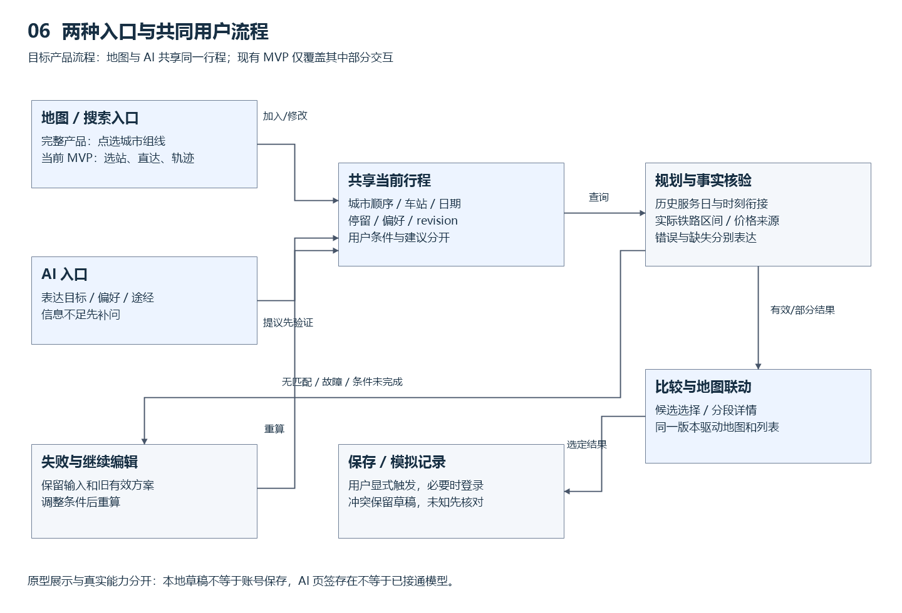
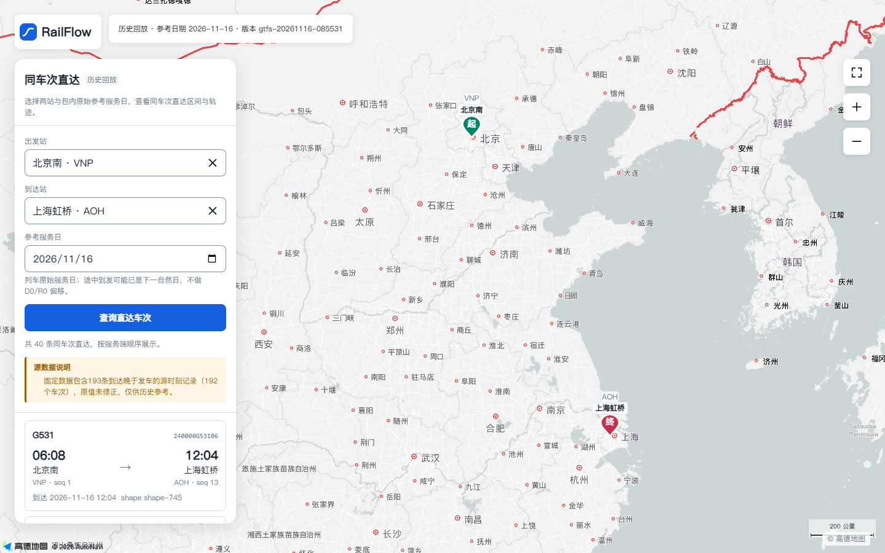
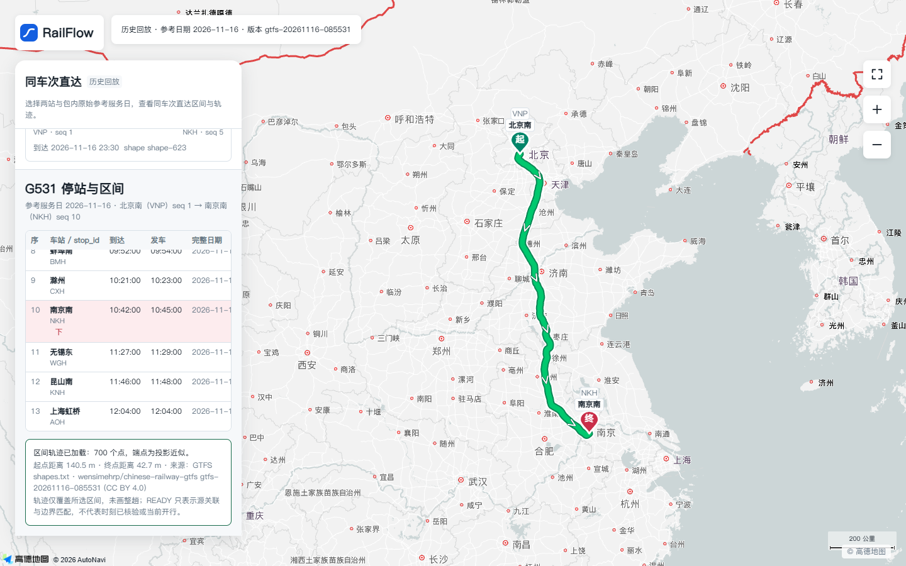
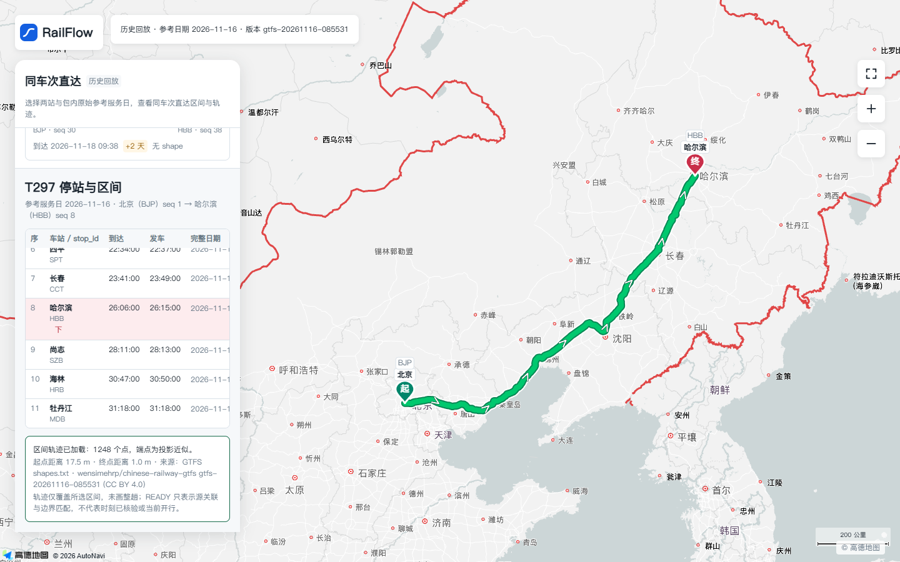
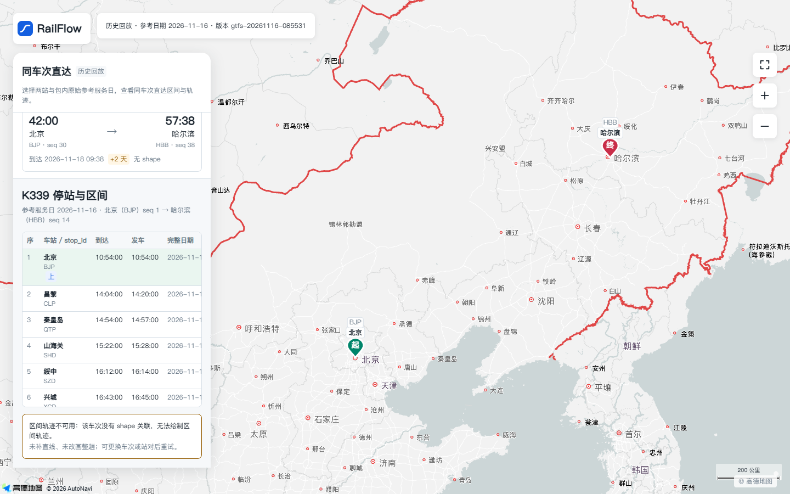
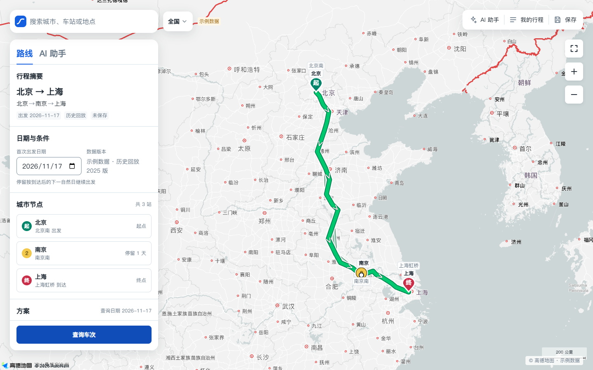
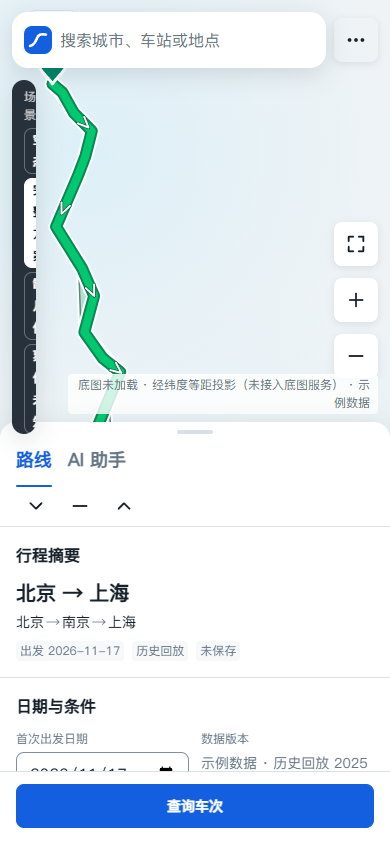
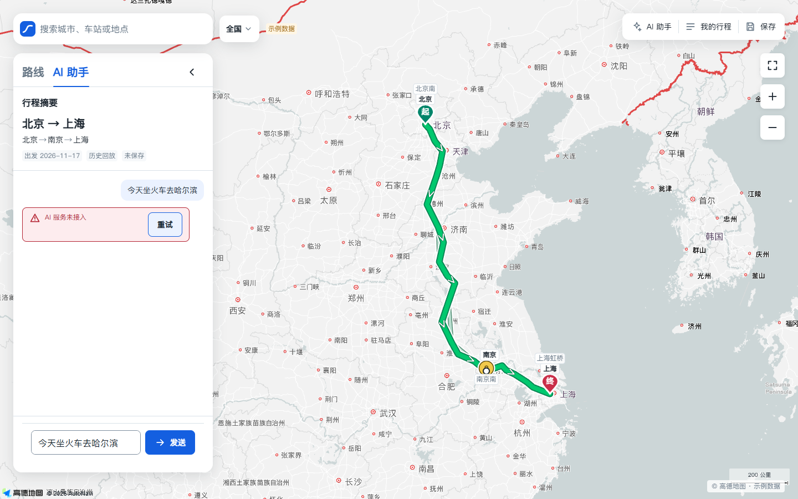

# UI 与 UX 设计

李司翰｜2453202｜CD-20261119

## 1. 信息架构与关键选择

地图是主要工作区，左上搜索用于城市/车站消歧与加入行程；左侧单一面板以"路线 / AI 助手 / 我的行程"复用空间。路线面板依次显示摘要、日期与条件、城市节点、候选及查询动作，保存入口集中在顶栏。对话和地图共享当前行程，切换页签不会建立第二份城市列表。

1440×900 桌面设计采用 360 宽面板、360×56 搜索框和 24 外边距；目标保留约 60% 无遮挡地图。移动端使用底部抽屉和固定关键动作，键盘弹出后仍能完成输入。必要帮助按需展开，来源与缺失说明靠近相应内容。

上述是多城市行程的完整产品结构。本轮按[需求 §2.1](requirements-update.md#scope-boundary)收敛后，实际实现的界面只保留同车次直达回放：搜索框、出发/到达站、参考服务日、查询动作、车次列表、停站表与区间地图，AI 页签、我的行程、多城编辑与多方案比较不再挂载。界面按"选择了什么就显示什么"组织，未实现的入口不摆放装饰性按钮。

## 2. 用户流程

图 6：[可编辑 SVG](figures/06-user-flow.svg)。实线表示目标主流程；异常框表示保留输入后恢复的路径，图示不是运行测试结果。

- 地图入口：选择城市 → 消歧/匹配车站 → 编辑顺序/日期/停留 → 查询参考方案 → 比较与查看区间 → 保存或模拟记录。
- AI 入口：输入意图 → 继承当前条件或补问 → 明确建议与用户条件 → 工具核验 → 更新同一方案和地图。
- 保存：需要身份时就近打开登录，成功后核对属主与待办快照再继续；冲突不覆盖，未知结果先核对。
- 无法规划：指出受影响段，保留城市、日期和此前有效方案，允许用户调整；不擅自删除城市。

本轮实现的同车次回放走的是上图主流程的收窄版本：选站与参考服务日 → 查询直达车次 → 选择车次 → 查看停站与区间轨迹；没有匹配、无开行、超出覆盖与轨迹不可用分别给出原因，并保留用户已选的站对与车次。

## 3. 核心结果态（已实现 MVP，真实数据）

本节四张图是 2026-11-20 00:18（对应 11-19 的实现与验收状态）在本地 `web` 部署上实拍：同一 Spring Boot 进程托管前端，连接真实 MySQL 中的固定 GTFS 包（版本 `gtfs-20261116-085531`，参考服务日 2026-11-16），底图为真实高德地图。截图按 1440×900 视口原样保存，未裁切、未改字，图内"历史回放 · 参考日期 · 版本"短标与高德来源署名可见。

### 3.1 候选结果列表

图 7：北京南（VNP）→ 上海虹桥（AOH），共 40 条同车次直达按服务端顺序展示。首条 G531 显示起终时刻、站码、乘坐区间与到达完整日期；顶部固定"历史回放 · 参考日期 · 版本"短标，列表上方给出源数据说明（固定包 193 条到达晚于发车的记录原值保留）。地图已标出起终点，未选车次时不画折线。

### 3.2 选中车次、停站与区间轨迹

图 8：北京南（VNP）→ 南京南（NKH）选中 G531。该车次全程 13 站，本轮只取 seq 1 → seq 10；面板给出参考服务日与上下车站序，停站表列出站名、站码、到达、发车与完整日期，上车站绿色、下车站红色标出。地图只绘制该区间被裁剪的轨迹（700 点），起点距北京南 140.5 m、终点距南京南 42.7 m，不延伸到后面的无锡东与上海虹桥；标注来源与 CC BY 4.0 署名。`READY` 只表示轨迹关联与边界匹配，不代表时刻已核验或当前开行。

### 3.3 跨日时刻

图 9：北京（BJP）→ 哈尔滨（HBB）选中 T297，区间为 seq 1 → seq 8。到达/发车显示 `26:06 / 26:15`，其后各站继续累计到 `31:18`，证明超过 24 小时的时刻按累计值保留、不截断成普通钟点。该图同时说明"参考服务日"与"用户行程日期"是两件事：图中时间是参考服务日上的完整时刻，尚未叠加行程日期。

### 3.4 轨迹不可用与保留状态

图 10：同一站对下选中 K339，该车次没有 shape 关联。面板显示"区间轨迹不可用"及原因，地图不画折线、不补直线、不改画整趟，选站、车次与文字结果全部保留，用户可更换车次或站对后重试。这是本轮"缺失不被另一种成功掩盖"的具体界面证据。

说明：360 宽面板内停站表的"完整日期"列可横向滚动查看；本轮 MVP 不做票价，界面因此不展示价格，也不摆"价格未知"占位，避免把未实现能力画成已实现。完整产品的票价未知、保存冲突等状态见 §5。

## 4. 完整产品目标态原型（界面设计参考）

下列三张图来自 2026-11-17 版本的界面，原样复制、未裁切，用于表达完整产品的多城市组线、移动端抽屉与 AI 未接入状态。该版界面随后按 MVP 范围收敛，AI 助手、我的行程、多城编辑与多方案比较在当前实现中不挂载，因此这三张图只作完整产品的界面设计参考，不能读作当前已实现界面，也不能据此判断 AI 或账号保存已接入。

### 4.1 桌面组线工作区

图 11：1440×900 的地图、三城市节点、自然日停留与查询动作。用于说明完整产品的空间组织与路线表达；画面中线路与"示例数据""2025 版"标识属于当时的合成夹具。

### 4.2 手机底部抽屉

图 12：390×844 的半展开抽屉与底部查询动作，显示底图降级与场景控件。未证明实机软键盘、触屏命中能力，仍交设备验证。

### 4.3 AI 未接入与恢复

图 13：输入保留、明确"AI 服务未接入"与重试入口，作为异常交互设计参考。产品 AI 的多轮有效提议状态见[架构 §5](architecture.md)与图 5。

## 5. 状态与恢复动作

| 状态 | 显示方式 | 用户下一步 |
| --- | --- | --- |
| 初始/加载 | 未满足必要字段时不提交；加载有占位与反馈 | 继续编辑，可取消旧计算 |
| 无匹配/日期不覆盖 | 标出相应区间与原因，区别网络故障 | 修改日期、车站或条件 |
| 缺几何 | 该段不连线，保留站点/文字结果 | 查看已知事实或重算，不用示意线伪装真实路线 |
| 票价未知 | 显示未知与缺失段数，已知合计不称总价 | 保留方案，不将未知当零或已满足预算 |
| 条件已改 | 旧结果标需重算，地图/列表一致 | 查询新条件，迟到结果不覆盖 |
| AI/POI/底图失败 | 分别反馈，输入和有效方案保留 | 手动组线、重试或查看有效数据 |
| 保存冲突/结果未知 | 保留本地草稿，显示核对动作 | 查看最新/另存/继续编辑；结果未知先查原请求 |

日期以北京时间明确显示行程日，历史回放标识与来源版本可查看；不出现"有票/无票/可售"承诺。相邻候选用编号、线型/粗细与文字冗余辨认，不能只靠颜色。

## 6. 可访问性与后续核验

输入法组合期不提交搜索，键盘可选择候选；关键按钮建议 44×44 点按区域、可见焦点和清晰可读名称。仅真正模态对话框锁定焦点，关闭后回到触发点；隐藏面板退出导航顺序。200% 缩放和 320 宽下，长站名不挡动作；减少动态效果设置得到尊重。

本轮实现没有单独做 MVP 外壳的键盘全流程与 390/320 设备级验收；11-17 版前端的键盘与窄屏记录只作历史参考，不能证明收敛后的界面。Firefox/Safari、iOS/Android 实机、软键盘与地图手势仍未验证；后续按固定设备记录操作、预期/实际、截图、数据版本和未覆盖项，形成独立结论。
